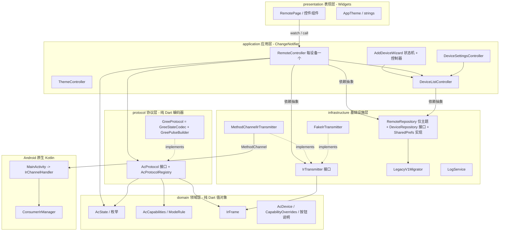
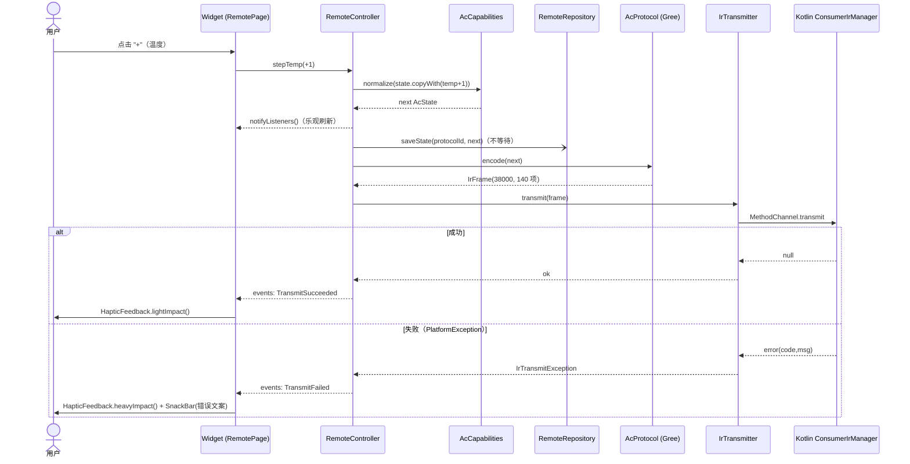

# flutter-aircon-remote 架构设计

**v0.3.0 变更**：①新增 Gree **水平扫风**（`HorizontalSwing`，Byte4 bit4–6）与垂直**局部自动扫风**（`autoDown/autoMiddle/autoUp`）；②对 `union GreeProtocol` 与 `IRGreeAC` 做完整缺口审计（表见 `docs/versions/0.3.0.md` §3），补全**华氏度**（`UseFahrenheit`/`TempExtraDegreeF`）、**定时**（实验）、**Wi‑Fi 一次性按键**，温度显示源改为按上游要求的**循环顺序**切换；明确**跳过** I‑Feel、Econo 位、health；③所有新能力沿用数据驱动模型：协议声明 ∩ 设备隐藏覆盖（新增 `hiddenHSwings`、`AcFeature.swingH/wifi/timer/fahrenheit`），隐藏或受模式限制时归一化为中性值；④新设备/迁移设备带「默认隐藏种子」`AcProtocol.recommendedOverrides`（水平扫风默认隐藏）；⑤持久化 schema v3 + 幂等迁移 `DeviceSchemaV3Migrator`，v0.2 设备与状态零丢失。详见 §20–§26；§1.2/§3/§4/§5.3/§5.6/§12/§14/§15/§16/§17 中带「v0.3.0 修订」标记处以新章节为准。

**v0.2.0 变更**：新增「多空调设备」(AcDevice / 首页列表 / 每台独立状态)、「添加空调 / 配对测试」向导（红外单向，无法自动发现）、协议型号移入设备设置并新增 Gree YX1FSF、按设备的能力覆盖 CapabilityOverrides 与「按钮说明」、持久化 schema v2 + v0.1 迁移。详见 §12–§19 与 `docs/versions/0.2.0.md`；§2/§3/§5/§7/§8/§9/§11 中带「v0.2.0 修订」标记处以新章节为准。

> 状态：设计稿 v2（v0.1.0 为 v1；本稿增补 0.2.0）。本文档是实现（Codex）的唯一依据；
> 文中类/文件/常量名即最终命名，代码标识符一律英文，说明为中文。
> 参考资料：`/workspace/refs/irremote/ir_Gree.{h,cpp}`、`ir_Gree_test.cpp`（IRremoteESP8266），
> 以及同作者的 `flutter-snake / tetris / music / bilibili-downloader-d4-qwen-code`。

---

## 1. 目标、非目标与约束

### 1.1 目标
- Android 专用 Flutter 应用，使用手机内置红外发射器（`android.hardware.ConsumerIrManager`）充当空调遥控器。
- 首个品牌：格力 Gree（YAW1F / YBOFB 协议，来自 IRremoteESP8266）。
- 功能：电源、模式（自动/制冷/除湿/送风/制热）、温度 16–30 °C、风速（自动/1/2/3 + 强劲 turbo）、
  垂直扫风（自动/关/固定位置）、附加项（灯光 light、换气/防霉 x-fan、睡眠 sleep、温度显示；健康 health 见 §5.3）。
- **每次按键发送完整状态**（空调 IR 协议是有状态的）。
- 状态跨启动持久化（`shared_preferences`）。
- 设备无红外发射器时给出友好提示，而不是崩溃或静默失败。
- 可扩展到其他品牌（Midea、Haier、Daikin…）：新增品牌 = 新增一个协议实现 + 注册，UI 零改动。
- 协议层为纯 Dart，可在无设备环境下 100% 单元测试，并对照 IRremoteESP8266 已知正确的字节向量。

### 1.2 非目标（0.1.0 不做）
- iOS / Windows / Web / 桌面；红外学习（接收）。（v0.2.0 修订：多设备档案已纳入 0.2.0，见 §12。）
- 定时器（timer）、华氏度、Wi-Fi 位、I-Feel、Econo 位、水平扫风：协议里固定写 0（见 §5.3）。
  **v0.3.0 修订**：水平扫风、华氏度、定时（实验）、Wi‑Fi 一次性按键已纳入 0.3.0（§20–§25）；**仍不做**：I‑Feel（上游无测温报文，手机无可信室温，见 §20.2）、Econo 位（真机帧恒 0，Econo 仅由 Mode=5 表达）、health。
- 读取空调真实状态、**自动发现/检测空调**（红外单向，无反馈；界面显示的是“假定状态”；0.2.0 用「配对测试」向导替代，见 §13）。
- 国际化：仅简体中文，字符串集中在 `presentation/strings.dart`，日后可替换为 l10n。
- 外接红外设备（USB/音频口）。

### 1.3 工程约束（与参考项目一致）
| 项 | 值 |
|---|---|
| Flutter / Dart | 3.47.7 / `sdk: '>=3.13.5 <4.0.0'` |
| 状态管理 | `provider 6.1.5+1`（`ChangeNotifier`） |
| 持久化 | `shared_preferences 2.5.5` |
| 日志落盘 | `path_provider 2.1.5` + `path 1.9.1` |
| Lint | `flutter_lints 6.0.0`，`analysis_options.yaml` 直接沿用 flutter-snake 的规则集 |
| Android | compileSdk/targetSdk **37**（Android 17），minSdk **35**，仅 `arm64-v8a` |
| 构建链 | AGP 9.2.1、Gradle 9.5.1、Kotlin 2.3.21、Java 21，Groovy `build.gradle`（非 KTS） |
| 包名 / 项目名 | `com.example.flutter_aircon_remote` / `flutter_aircon_remote` |
| 版本 | `0.1.0`（`pubspec.yaml` 与 `AppConstants.version` 同步） |
| 文档 | `plan.md`（版本规划，由实现者创建并维护）、`prompt.md`（若存在，禁止修改） |
| 代码量 | 手写 Dart + Kotlin < 10000 行（预计 ~3000 行含测试） |

---

## 2. 分层架构



**依赖规则（必须遵守，由 `test/architecture_test.dart` 以 import 扫描方式强制）**
1. `domain` 不依赖任何其他层，也不 import `package:flutter`（纯 Dart，`dart:convert` 除外）。
2. `protocol` 只依赖 `domain`；不得 import `flutter`、`dart:io`、platform channel。
3. `infrastructure` 只依赖 `domain`（用到 `IrFrame`/`AcState`/`AcDevice`）、`core` 与平台 API；不得依赖 `protocol` / `application`。
   （v0.2.0 修订：`LegacyV1Migrator` 不得知道协议注册表，仅收到字符串 `fallbackProtocolId`。）
4. `application` 依赖 `domain`、`protocol` 接口、`infrastructure` **接口**；不 import `package:flutter/material.dart`
   （可 import `package:flutter/foundation.dart` 取 `ChangeNotifier`）。
5. `presentation` 只依赖 `application` 与 `domain`（读取枚举/能力）；不得直接触碰 `protocol` 具体类或 `infrastructure`
   （`DiagnosticsSheet` 经 `RemoteController` 暴露的 `logSnapshot()` 取日志，不直接 import `LogService`）。
   （v0.2.0 修订：日志改经 `DiagnosticsController`；协议信息经 application 的 `ProtocolOption` 视图类暴露，presentation 仍不得 import `protocol/`。）
6. 依赖注入集中在 `main.dart`（composition root）；所有具体实现在此装配，其余位置只见接口。

数据流（v0.2.0 修订：这里的 `AcCapabilities` 是**有效能力** = 协议能力 ∩ 设备覆盖，见 §12.3）：用户操作 → `RemoteController` 修改 `AcState`（经 `AcCapabilities.normalize`）→ 持久化 →
`AcProtocol.encode` 得到 `IrFrame` → `IrTransmitter.transmit` → Kotlin `ConsumerIrManager.transmit`。

---

## 3. 目录与文件布局

### 3.1 `lib/`
```
lib/
├─ main.dart                              # composition root：初始化日志、装配依赖、runApp
├─ app.dart                               # AircondRemoteApp：MultiProvider + MaterialApp(theme/darkTheme)
├─ core/
│  └─ constants.dart                      # AppConstants { appName, version='0.3.0', irChannelName, schema/设备 prefs keys }（v0.2.0 修订；v0.3.0 修订：version=0.3.0，schema 版本为 3）
├─ domain/
│  ├─ ac_enums.dart                       # AcMode, FanSpeed, VerticalSwing, TempDisplay, AcFeature（v0.3.0 修订：+HorizontalSwing；VerticalSwing 追加 autoDown/autoMiddle/autoUp；AcFeature 追加 swingH/wifi/timer/fahrenheit）
│  ├─ fahrenheit_step.dart                # 〔v0.3.0〕FahrenheitStep(f, c) 值对象；AcCapabilities 据此做华氏范围/换算（纯 Dart）
│  ├─ ac_state.dart                       # AcState 不可变值对象 + JSON
│  ├─ ac_capabilities.dart                # AcCapabilities, ModeRule, normalize()
│  ├─ ir_frame.dart                       # IrFrame：carrierHz + patternMicros（+ 校验）
│  ├─ ac_device.dart                      # 〔v0.2.0〕AcDevice, AcIcon
│  ├─ capability_overrides.dart           # 〔v0.2.0〕CapabilityOverrides（AcCapabilities.restrictedBy 在 ac_capabilities.dart）
│  └─ capability_explainer.dart           # 〔v0.2.0〕explainControls() 纯函数，供「按钮说明」
├─ protocol/
│  ├─ ac_protocol.dart                    # abstract interface class AcProtocol
│  ├─ protocol_registry.dart              # AcProtocolRegistry（品牌/型号列表、byId）
│  ├─ pulse/
│  │  └─ pulse_timing.dart                # PulseTimings + appendBitsLsbFirst（可复用于其他品牌）
│  └─ gree/
│     ├─ gree_constants.dart              # 位域位置、枚举数值、时序常量；〔v0.3.0〕greeFahrenheitTable（26 行）、垂直/水平扫风原生值显式表
│     ├─ gree_state_codec.dart            # AcState <-> 8 字节（含校验和）
│     ├─ gree_pulse_builder.dart          # 8 字节 -> List<int> 微秒序列（含中间 footer 与 gap）
│     └─ gree_protocol.dart               # GreeProtocol(GreeModel)：组合 codec + builder + capabilities
├─ infrastructure/
│  ├─ ir/
│  │  ├─ ir_transmitter.dart              # abstract IrTransmitter, IrTransmitException, IrErrorCode, CarrierRange
│  │  ├─ method_channel_ir_transmitter.dart
│  │  └─ fake_ir_transmitter.dart         # 记录发送帧，可注入失败；测试与 --dart-define=FAKE_IR=true 使用
│  ├─ persistence/
│  │  ├─ remote_repository.dart           # abstract RemoteRepository + PersistedRemote（v0.2.0 修订：仅主题）
│  │  ├─ shared_prefs_remote_repository.dart
│  │  ├─ device_repository.dart           # 〔v0.2.0〕abstract DeviceRepository
│  │  ├─ shared_prefs_device_repository.dart # 〔v0.2.0〕schema v2 JSON
│  │  ├─ legacy_v1_migrator.dart          # 〔v0.2.0〕v0.1 -> v2 一次性迁移
│  │  └─ device_schema_v3_migrator.dart   # 〔v0.3.0〕v2 -> v3：并入默认隐藏种子，幂等（§24）
│  └─ logging/
│     └─ log_service.dart                 # 按日落盘日志，风格同 flutter-snake 的 LogService
├─ application/
│  ├─ remote_controller.dart              # RemoteController：〔v0.2.0 修订：每台设备一个〕状态、IR 可用性、发送串行化；〔v0.3.0〕注入时钟、一次性 wifiPulse、定时折算（§23）
│  ├─ remote_event.dart                   # sealed RemoteEvent（一次性事件：发送成功/失败/设备被删除）
│  ├─ remote_session_factory.dart         # 〔v0.2.0〕按 deviceId 创建 RemoteController
│  ├─ device_list_controller.dart         # 〔v0.2.0〕设备 CRUD / 排序 / 状态落盘的唯一入口
│  ├─ device_settings_controller.dart     # 〔v0.2.0〕设置页草稿、有效能力预览、ProtocolOption
│  ├─ add_device_wizard.dart              # 〔v0.2.0〕纯状态机 AddDeviceWizard（WizardState/Event/Effect）
│  ├─ add_device_wizard_controller.dart   # 〔v0.2.0〕执行 effect（发探测帧）的 ChangeNotifier
│  ├─ diagnostics_controller.dart         # 〔v0.2.0〕转发 LogService（从 RemoteController 迁出）
│  └─ theme_controller.dart               # ThemeController：主题模式名持久化（String，不含 Flutter 类型）
└─ presentation/
   ├─ strings.dart                        # 所有中文文案常量
   ├─ theme/app_theme.dart                # 亮/暗 ThemeData（Material 3, seedColor）
   ├─ pages/
   │  ├─ home_page.dart                   # 〔v0.2.0〕空调列表（首页）：空状态/增删改/拖拽排序/主题/诊断
   │  ├─ remote_page.dart                 # 某台空调的遥控页（AppBar 显示设备名）
   │  ├─ add_device_page.dart             # 〔v0.2.0〕添加空调 / 配对测试向导（也用于重新配对）
   │  ├─ device_settings_page.dart        # 〔v0.2.0〕名称/房间/图标、遥控协议型号、功能显示开关、删除
   │  ├─ control_help_sheet.dart          # 〔v0.2.0〕按钮说明
   │  └─ diagnostics_sheet.dart           # 底部弹窗：版本、日志路径、最近日志、复制
   └─ widgets/
      ├─ no_ir_banner.dart
      ├─ （v0.2.0 删除 brand_selector.dart；协议型号下拉移入 device_settings_page）
      ├─ power_button.dart
      ├─ temperature_display.dart         # 大号温度 + (−/+) 按钮，长按连发
      ├─ mode_selector.dart               # SegmentedButton，选项由 capabilities 决定
      ├─ fan_selector.dart
      ├─ swing_selector.dart              # 垂直扫风；〔v0.3.0〕新增 horizontal_swing_selector.dart（水平扫风 ChoiceChip 组）
      ├─ feature_toggles.dart             # FilterChip 组：turbo/light/health/xfan/sleep；〔v0.3.0 修订〕温度显示改为「下一档」按钮，新增 Wi‑Fi 一次性按钮
      ├─ unit_toggle.dart                 # 〔v0.3.0〕℃/℉ 分段按钮（fahrenheit 特性可见时）
      └─ timer_chip.dart                  # 〔v0.3.0〕定时入口 + 选择 sheet + 剩余时间（timer 特性可见时）
```

### 3.2 `test/`
```
test/
├─ support/
│  ├─ gree_vectors.dart                   # 从 ir_Gree_test.cpp 摘取的已知字节向量（见 §5.6）
│  ├─ in_memory_remote_repository.dart
│  └─ pump_app.dart                       # widget 测试装配
├─ domain/
│  ├─ ac_state_test.dart                  # copyWith / == / JSON 往返 / 容错解析
│  └─ ac_capabilities_test.dart           # normalize：夹取、模式约束、幂等
├─ protocol/
│  ├─ pulse_timing_test.dart
│  ├─ gree_checksum_test.dart
│  ├─ gree_state_codec_test.dart          # 对照已知向量，encode + decode
│  ├─ gree_pulse_builder_test.dart
│  ├─ gree_protocol_test.dart             # 端到端 AcState -> IrFrame
│  └─ protocol_registry_test.dart
├─ infrastructure/
│  ├─ method_channel_ir_transmitter_test.dart   # mock MethodChannel，错误码映射
│  └─ shared_prefs_remote_repository_test.dart  # SharedPreferences.setMockInitialValues
├─ application/
│  └─ remote_controller_test.dart         # FakeIrTransmitter + InMemory repo
├─ presentation/
│  └─ remote_page_test.dart               # 无 IR 横幅、控件随 capabilities 显隐/禁用
├─ （v0.2.0 新增/修改的测试文件完整清单见 §18；v0.3.0 见 §26）
├─ architecture_test.dart                 # 扫描 lib/ 的 import，校验 §2 依赖规则
└─ version_test.dart                      # AppConstants.version == pubspec.yaml 的 version
```

### 3.3 关键接口签名（仅接口，实现由 Codex 完成）

> v0.2.0 修订：`AcMode` 追加 `econo`；`AcProtocol` 追加 `modelNote`、`pairingProbe`；`RemoteRepository` 仅保留主题；`RemoteController` 改为每设备一个。以 §12–§15 的签名为准，下方 0.1.0 签名中相应部分作废。

```dart
// ---- domain/ac_enums.dart ----
enum AcMode { auto, cool, dry, fan, heat }
enum FanSpeed { auto, low, medium, high }                    // turbo 是独立开关，不在此枚举
enum VerticalSwing { off, auto, highest, high, middle, low, lowest }
enum TempDisplay { off, setpoint, indoor, outdoor }
enum AcFeature { turbo, light, health, xfan, sleep, tempDisplay }

// ---- domain/ir_frame.dart ----
final class IrFrame {
  const IrFrame({required this.carrierHz, required this.patternMicros, this.debugHex = ''});
  final int carrierHz;               // 例如 38000
  final List<int> patternMicros;     // [mark, space, mark, space, ...]，单位 µs，全部 > 0
  final String debugHex;             // 仅用于日志，如 "19 0A 60 50 02 23 00 F0"
  int get totalMicros;
  void validate({int maxMicros = 2000000, int maxEntries = 1000}); // 违反抛 ArgumentError
}

// ---- protocol/ac_protocol.dart ----
abstract interface class AcProtocol {
  String get id;            // 全局唯一，如 'gree.yaw1f'（持久化用，发布后不可改名）
  String get brandId;       // 'gree'
  String get brandName;     // '格力 Gree'
  String get modelName;     // 'YAW1F'
  AcCapabilities get capabilities;
  AcState get defaultState;
  IrFrame encode(AcState state);   // 内部先 capabilities.normalize(state)；纯函数，无副作用
}

// ---- protocol/protocol_registry.dart ----
class AcProtocolRegistry {
  AcProtocolRegistry(List<AcProtocol> protocols);   // id 重复 → StateError；列表为空 → StateError
  List<AcProtocol> get all;
  List<String> get brandIds;                         // 保持注册顺序
  List<AcProtocol> modelsOf(String brandId);
  AcProtocol? byId(String id);
  AcProtocol get fallback;                           // 第一个注册项（gree.yaw1f）
}

// ---- infrastructure/ir/ir_transmitter.dart ----
enum IrErrorCode { noIrEmitter, invalidArgument, patternTooLong,
                   unsupportedFrequency, permissionDenied, transmitFailed, platform }
class IrTransmitException implements Exception {
  const IrTransmitException(this.code, this.message);
  final IrErrorCode code; final String message;
}
class CarrierRange { const CarrierRange(this.minHz, this.maxHz); final int minHz, maxHz; }
abstract interface class IrTransmitter {
  Future<bool> hasIrEmitter();
  Future<List<CarrierRange>> getCarrierFrequencies();   // 无发射器返回空列表
  Future<void> transmit(IrFrame frame);                 // 失败抛 IrTransmitException
}

// ---- infrastructure/persistence/remote_repository.dart ----
// 不引入 Flutter 类型：主题模式以 String（'system' | 'light' | 'dark'）读写，ThemeController 负责与 ThemeMode 互转。
class PersistedRemote {
  const PersistedRemote({this.protocolId, this.states = const {}, this.themeModeName});
  final String? protocolId;
  final Map<String, AcState> states;      // key = protocolId
  final String? themeModeName;
}
abstract interface class RemoteRepository {
  Future<PersistedRemote> load();         // 任何损坏数据 → 对应字段缺省，不抛
  Future<void> saveState(String protocolId, AcState state);
  Future<void> saveProtocolId(String protocolId);
  Future<void> saveThemeModeName(String name);
}

// ---- application/remote_controller.dart ----
enum IrAvailability { unknown, available, unavailable }
class RemoteController extends ChangeNotifier {
  RemoteController({required AcProtocolRegistry registry, required IrTransmitter transmitter,
                    required RemoteRepository repository});
  AcProtocolRegistry get registry;
  AcProtocol get protocol;
  AcState get state;
  AcCapabilities get capabilities => protocol.capabilities;
  IrAvailability get irAvailability;
  bool get isSending;
  Stream<RemoteEvent> get events;                       // broadcast
  Future<void> init();                                  // 读持久化 + 探测 IR；失败回落默认值；不发码
  Future<void> update(AcState Function(AcState s) mutate);  // 通用入口：normalize→notify→persist→send
  Future<void> setProtocol(String protocolId);          // 切换品牌/型号：加载该协议的已存状态，不发码
  Future<void> recheckIr();                             // 横幅“重新检测”
  // 以下均为 update 的语法糖：
  Future<void> togglePower();
  Future<void> setMode(AcMode m);        Future<void> stepTemp(int delta);
  Future<void> setFan(FanSpeed f);       Future<void> setSwing(VerticalSwing s);
  Future<void> toggleFeature(AcFeature f);   Future<void> setTempDisplay(TempDisplay d);
  List<String> logSnapshot([int n = 200]);  String logFilePath();   // 诊断页用，转发 LogService
}
sealed class RemoteEvent {}
final class TransmitSucceeded extends RemoteEvent {}
final class TransmitFailed extends RemoteEvent {
  TransmitFailed(this.code, this.message);
  final IrErrorCode code; final String message;
}
```

---

## 4. 领域状态模型

### 4.1 `AcState`（不可变、值相等）
| 字段 | 类型 | 取值/范围 | 默认 |
|---|---|---|---|
| `power` | `bool` | | `false` |
| `mode` | `AcMode` | auto/cool/dry/fan/heat | `cool` |
| `targetTempC` | `int` | `capabilities.minTempC..maxTempC`（Gree 16..30） | `26` |
| `fan` | `FanSpeed` | auto/low/medium/high | `auto` |
| `turbo` | `bool` | 强劲（独立于 fan） | `false` |
| `verticalSwing` | `VerticalSwing` | off/auto/highest/high/middle/low/lowest | `off` |
| `light` | `bool` | 机身显示灯 | `true` |
| `health` | `bool` | 健康/负离子（能力位，Gree 0.1.0 不支持，见 §5.3） | `false` |
| `xfan` | `bool` | 换气/防霉（关机后吹干） | `false` |
| `sleep` | `bool` | 睡眠 | `false` |
| `tempDisplay` | `TempDisplay` | off/setpoint/indoor/outdoor | `off` |
| `horizontalSwing` | `HorizontalSwing` | **v0.3.0 修订** off/auto/maxLeft/left/middle/right/maxRight | `off` |
| `targetTempF` | `int?` | **v0.3.0 修订** `null`=摄氏；非空=华氏模式（61..86，且为 `fahrenheitSteps` 内的值） | `null` |
| `timerMinutes` | `int` | **v0.3.0 修订** 0 或 30..1440，30 的倍数 | `0` |
| `timerSetAtMs` | `int?` | **v0.3.0 修订** 设定时刻（epoch ms）；`timerMinutes>0 ⇔ 非空` | `null` |
| `wifiPulse` | `bool` | **v0.3.0 修订** 一次性按键标记：只存在于内存与单帧，**不持久化**（`toJson` 不写，`fromJson` 恒 false） | `false` |

v0.3.0 修订：`verticalSwing` 取值扩展为 off/auto/highest/high/middle/low/lowest/**autoDown/autoMiddle/autoUp**（枚举追加在末尾，持久化用 name）。`useFahrenheit` 是派生 getter（`targetTempF != null`），不另存字段；华氏模式下 `targetTempC` 仍保留，由 `targetTempF` 经协议华氏表派生（供范围、模式规则、解码测试使用）。`toJson` 的 `'v'` 升为 2；v0.2 JSON（`'v':1`、无新键）读取为各字段默认。`copyWith` 对 `targetTempF`、`timerSetAtMs` 这类可空字段使用哨兵参数（`Object? x = _unset`），与 `CapabilityOverrides.copyWith` 一致。

```dart
@immutable
final class AcState {
  const AcState({required this.power, required this.mode, required this.targetTempC,
    required this.fan, required this.turbo, required this.verticalSwing, required this.light,
    required this.health, required this.xfan, required this.sleep, required this.tempDisplay});
  const AcState.initial();                       // 即上表默认值
  AcState copyWith({bool? power, AcMode? mode, int? targetTempC, FanSpeed? fan, bool? turbo,
    VerticalSwing? verticalSwing, bool? light, bool? health, bool? xfan, bool? sleep,
    TempDisplay? tempDisplay});                  // 所有字段非空，故无需 sentinel
  Map<String, Object?> toJson();                 // {'v':1,'power':..,'mode':'cool',...} 枚举用 name
  factory AcState.fromJson(Map<String, Object?> json); // 容错：缺失/未知枚举名/类型错误 → 该字段取默认值；不抛异常
  // == / hashCode / toString 基于全部字段
}
```
JSON 带 `v: 1` schema 版本，便于日后迁移；`fromJson` 永不抛出（损坏数据回落默认值，由调用方记 WARN）。
`AcState` 本身**不做**范围校验（可构造任意 `targetTempC`），合法性统一由 `AcCapabilities.normalize` 保证。

### 4.2 品牌无关能力模型 `AcCapabilities`
```dart
class ModeRule {                                  // 每个模式的约束
  const ModeRule({this.fixedTempC, this.tempEditable = true, this.fixedFan,
                  this.allowedFeatures = const {}});
  final int? fixedTempC;          // 非空：该模式温度被锁定（Gree auto = 25）
  final bool tempEditable;        // false：UI 禁用温度按钮（fan 模式；沿用 state 中的值）
  final FanSpeed? fixedFan;       // 非空：风速被锁定（Gree dry = low）
  final Set<AcFeature> allowedFeatures;
}
class AcCapabilities {
  const AcCapabilities({required this.minTempC, required this.maxTempC,
    required this.modes, required this.fanSpeeds, required this.verticalSwings,
    required this.tempDisplays, required this.features, required this.modeRules});
  final int minTempC, maxTempC;
  final List<AcMode> modes;                 // 决定 ModeSelector 的选项
  final List<FanSpeed> fanSpeeds;
  final List<VerticalSwing> verticalSwings; // 空列表 = 不显示扫风控件
  final List<TempDisplay> tempDisplays;     // 至少含 off
  final Set<AcFeature> features;            // 协议整体支持的附加项（UI 显隐）；tempDisplay 是否显示也由此决定
  final Map<AcMode, ModeRule> modeRules;    // 必须覆盖 modes 中的每一项
  AcState normalize(AcState s);             // 纯函数，幂等
  bool isFeatureEnabled(AcState s, AcFeature f);   // f ∈ features ∩ modeRules[s.mode].allowedFeatures（UI 可点击性）
  bool canEditTemp(AcState s);  bool canEditFan(AcState s);
}
```
**`normalize` 规则（按序执行，幂等；`power` 不受影响）**
1. 枚举越权：`mode ∉ modes` → `modes.first`；`fan ∉ fanSpeeds` → `fanSpeeds.first`；
   `verticalSwing ∉ verticalSwings` → `off`；`tempDisplay ∉ tempDisplays` → `off`。
2. 温度夹取到 `[minTempC, maxTempC]`。
3. 应用 `modeRules[mode]`：`fixedTempC != null` → 覆盖温度；`fixedFan != null` → 覆盖风速。
4. 特性裁剪：对每个 `AcFeature f`，若 `f ∉ features ∩ rule.allowedFeatures`，置为关闭值
   （bool → `false`，`tempDisplay` → `off`）。
   注意：切换模式会丢弃不被新模式允许的开关，再切回不恢复（可接受，保持逻辑简单；README 说明）。

**Gree 的具体能力（`GreeProtocol.capabilities`）**
| 模式 | 温度 | 风速 | 允许特性 |
|---|---|---|---|
| auto | 锁定 25 | 任意 | light, sleep, tempDisplay |
| cool | 16–30 | 任意 | turbo, light, xfan, sleep, tempDisplay |
| dry | 16–30 | 锁定 low（IRremote：`setFan` 在 Dry 下强制 1） | light, xfan, sleep, tempDisplay |
| fan | 不可调（沿用 state 值） | 任意 | light, tempDisplay |
| heat | 16–30 | 任意 | turbo, light, sleep, tempDisplay |

`features` 整体 = {turbo, light, xfan, sleep, tempDisplay}（**不含 health**，见 §5.3）；
`verticalSwings` = 全部 7 项；`tempDisplays` = {off, setpoint, indoor, outdoor}；`fanSpeeds` = 全部 4 项。
上表中 turbo/xfan/sleep 的模式限制来自实际遥控器行为的保守取值，IRremoteESP8266 本身只强制 Auto 锁温与 Dry 锁风速；
这些规则集中在 `GreeProtocol` 的一张表里，后续按实测放宽只需改表和对应测试。

**v0.3.0 修订（`AcCapabilities` 新增字段与规则，完整定义见 §21）**
- 新增构造参数：`horizontalSwings: List<HorizontalSwing>`（空=不支持）、`fahrenheitSteps: List<FahrenheitStep>`（空=不支持华氏）、`timerStepMinutes`/`maxTimerMinutes`（0=不支持定时）。
- `features` 新增 `swingH`、`wifi`、`timer`、`fahrenheit`；Gree 三个变体均声明，且**每个 `ModeRule.allowedFeatures` 都包含这四项**（上游对它们没有模式限制）。
- `verticalSwings` = 全部 10 项；`horizontalSwings` = 全部 7 项。
- `normalize` 在原 4 步基础上增补：水平扫风、华氏/摄氏、定时、Wi‑Fi 一次性标记（见 §21.3）。

---

## 5. 协议层

### 5.1 管线
```
AcState --normalize--> AcState' --GreeStateCodec.encode--> Uint8List(8) [含校验和]
        --GreePulseBuilder.build--> List<int> patternMicros --> IrFrame(carrierHz: 38000, ..., debugHex)
```
`GreeProtocol` 仅做组合，构造参数 `GreeModel { yaw1f, ybofb }`（只影响 ModelA 位）。注册为两个协议项：
`gree.yaw1f`（默认，modelName `YAW1F`）与 `gree.ybofb`（`YBOFB`），同属品牌 `gree`。

```dart
// gree_state_codec.dart —— 纯函数，无时序知识
enum GreeModel { yaw1f, ybofb }
final class GreeStateCodec {
  const GreeStateCodec(this.model);
  final GreeModel model;
  Uint8List encode(AcState normalized);          // 长度恒为 8，已写入校验和
  AcState decode(Uint8List bytes);               // 仅测试/调试用（把已知向量解回 AcState）；忽略不支持的位
  static int checksum(List<int> bytes);          // 返回 0..15
  static bool isValid(List<int> bytes);          // 长度 8 且 bytes[7] 高半字节 == checksum
}
// gree_pulse_builder.dart —— 纯函数，无状态语义
final class GreePulseBuilder {
  const GreePulseBuilder();
  List<int> build(Uint8List bytes);              // 长度必须为 8，否则 ArgumentError
}
// pulse/pulse_timing.dart —— 可被其他品牌复用
final class PulseTimings {
  const PulseTimings({required this.headerMark, required this.headerSpace, required this.bitMark,
                      required this.oneSpace, required this.zeroSpace, required this.gapSpace});
}
void appendBitsLsbFirst(List<int> out, int value, int bitCount, PulseTimings t); // 每位追加 mark+space
```

### 5.2 时序与帧结构（对应 `IRsend::sendGree(const uint8_t data[], ...)`）
常量（`gree_constants.dart`）：`hdrMark=9000, hdrSpace=4500, bitMark=620, oneSpace=1600, zeroSpace=540, msgSpace=19980, carrierHz=38000, blockFooter=0b010（3 位）`。

位序：**每个字节 LSB 先发**；字节顺序 byte0→byte7；footer 的 3 位按 LSB 先发为 0,1,0（回文，无歧义）。

```
[hdrMark 9000][hdrSpace 4500]
 byte0..byte3 : 32 位，每位 [620][540 或 1600]（0→540，1→1600）
 footer 3 位  : 0,1,0 → [620][540] [620][1600] [620][540]
 [bitMark 620][msgSpace 19980]            ← 块 1 结束的 gap
 byte4..byte7 : 32 位
 [bitMark 620][msgSpace 19980]            ← 消息结束 footer
```
条目数 = 2 + 64 + 6 + 2 + 64 + 2 = **140**（偶数，mark 起、space 终）。
下标：header `p[0..1]`；块 1 `p[2..65]`；footer 位 `p[66..71]`；块间 mark+gap `p[72..73]`；块 2 `p[74..137]`；结尾 mark+gap `p[138..139]`。
总时长约 0.15–0.21 s，远小于 2 s 上限。
默认**只发送一次**（IRremote 的 `kGreeDefaultRepeat = 0`，与真实遥控器一致）；不引入 repeat 参数，保持 `IrFrame` 简单。

### 5.3 字节/位映射表（LSB = bit0；与 `union GreeProtocol` 位域一致）
> **v0.3.0 修订：本表已覆盖联合体全部 64 位，无遗漏**（每个字段、每个无名保留位都出现）。「校验和」列标明该位所在半字节是否参与校验和（见下）。

| Byte | 位 | 字段（`ir_Gree.h`） | AcState 来源 / 取值 | 校验和 |
|---|---|---|---|---|
| 0 | 0–2 | Mode | auto=0, cool=1, dry=2, fan=3, heat=4，**econo=5（仅 YX1FSF，v0.2）**；6、7 不使用 | 低半字节 ✔ |
| 0 | 3 | Power | `power` | 低 ✔ |
| 0 | 4–5 | Fan | auto=0, low=1, medium=2, high=3 | 高 ✘ |
| 0 | 6 | SwingAuto | **v0.3.0 修订**：`verticalSwing ∈ {auto, autoDown, autoMiddle, autoUp}` 时为 1，其余 0 | 高 ✘ |
| 0 | 7 | Sleep | `sleep` | 高 ✘ |
| 1 | 0–3 | Temp | 摄氏：`targetTempC − 16`（0..14）；**v0.3.0 修订**华氏：`greeFahrenheitTable[F].c − 16` | 低 ✔ |
| 1 | 4 | TimerHalfHr | **v0.3.0**：`(timerMinutes % 60) >= 30` | 高 ✘ |
| 1 | 5–6 | TimerTensHr | **v0.3.0**：`(timerMinutes ~/ 60) ~/ 10`（0..2） | 高 ✘ |
| 1 | 7 | TimerEnabled | **v0.3.0**：`timerMinutes >= 30` | 高 ✘ |
| 2 | 0–3 | TimerHours | **v0.3.0**：`(timerMinutes ~/ 60) % 10`（BCD 个位） | 低 ✔ |
| 2 | 4 | Turbo | `turbo` | 高 ✘ |
| 2 | 5 | Light | `light` | 高 ✘ |
| 2 | 6 | ModelA | `power && model == yaw1f`（**关机时为 0**，见 Issue814 向量）；v0.2.0：`power && (model == yaw1f || model == yx1fsf)`（§17） | 高 ✘ |
| 2 | 7 | Xfan | `xfan` | 高 ✘ |
| 3 | 0–1 | （无名保留） | 0 | 低 ✔ |
| 3 | 2 | TempExtraDegreeF | **v0.3.0**：华氏表的 `extra`；摄氏恒 0 | 低 ✔ |
| 3 | 3 | UseFahrenheit | **v0.3.0**：`targetTempF != null` | 低 ✔ |
| 3 | 4–7 | unknown1 | 固定 `0b0101`（Byte3 = 0x50，再或上 F 位 0x0C） | 高 ✘ |
| 4 | 0–3 | SwingV | 显式原生值表（**禁止用 enum.index**）：off=0（kGreeSwingLastPos，保持上次位置）, auto=1, highest=2（Up）, high=3（MiddleUp）, middle=4, low=5（MiddleDown）, lowest=6（Down）, **autoDown=7, autoMiddle=9, autoUp=11**；8、10、12–15 不使用（解码→off） | 低 ✘ |
| 4 | 4–6 | SwingH | **v0.3.0**：off=0, auto=1, maxLeft=2, left=3, middle=4, right=5, maxRight=6；7 不使用（上游 `setSwingHorizontal(>6)` → Off） | 高 ✔ |
| 4 | 7 | （无名保留） | 0 | 高 ✔ |
| 5 | 0–1 | DisplayTemp | off=0, setpoint=1, indoor=2, outdoor=3 | 低 ✘ |
| 5 | 2 | IFeel | **恒 0（v0.3.0 决策：不支持，§20.2）**；解码忽略 | 低 ✘ |
| 5 | 3–5 | unknown2 | 固定 `0b100`（该字节基准值 0x20） | bit3 ✘；bit4–5 ✔（bit5 恒 1，bit4 恒 0） |
| 5 | 6 | WiFi | **v0.3.0**：`wifiPulse`（一次性，仅当次帧） | 高 ✔ |
| 5 | 7 | （无名保留） | 0 | 高 ✔ |
| 6 | 0–7 | （无名保留） | 0 | 高半字节 ✔，低半字节 ✘ |
| 7 | 0–1 | （无名保留） | 0 | ✘ |
| 7 | 2 | Econo | 恒 0（v0.3.0 决策：不写，真机帧恒 0，Econo 仅由 Mode=5 表达） | ✘ |
| 7 | 3 | （无名保留） | 0 | ✘ |
| 7 | 4–7 | Sum | 校验和（见下） | — |

「校验和」列精确含义：校验和 = 10 + Σ(Byte0..3 的**低**半字节) + Σ(Byte4..6 的**高**半字节)。因此 ✔ 表示该位所在的半字节参与求和（Byte0–3 的低半字节；Byte4–6 的高半字节）。注意定时的 Byte1 高半字节（Half/Tens/Enabled）**不**参与，而 Byte2 低半字节（TimerHours）参与；SwingH、WiFi、unknown2 的位在 Byte4/5 的高半字节中参与，SwingV 与 DisplayTemp 在低半字节中不参与。「✘」仅表示不参与，位值照常写入。

其余未列位均为 0（本表已无遗漏）。**基准帧**（IRremote `stateReset`）：`00 09 20 50 00 20 00 50`（关机/自动/25 °C/灯亮）。

**健康（health）**：IRremoteESP8266 的 Gree 位域**没有**文档化的 health/ionizer 位，本项目不得臆造。
0.1.0：`AcState.health` 与 `AcFeature.health` 保留在领域层，Gree 能力集不声明该特性（UI 自动不显示，编码不写任何位）。
若日后拿到经实机验证的位位置，只需在 `GreeStateCodec` 增加一行、把 `health` 加入 `features` 与 `modeRules`，并补向量测试。

**校验和**（Kelvinator `calcBlockChecksum`，Gree 复用；该函数不在参考文件中，以此处为准）：
```
sum = 10
for i in 0..3: sum += bytes[i] & 0x0F        // 前 4 字节的低半字节
for i in 4..6: sum += bytes[i] >> 4          // byte4..6 的高半字节
checksum = sum & 0x0F                        // 写入 bytes[7] 高 4 位：bytes[7] = (checksum << 4) | (bytes[7] & 0x0F)
```
手工验证：`00 09 20 50 00 20 00 50` → 10+0+9+0+0+0+2+0=21 → 5 ✓；
`19 0A 60 50 02 23 00 F0` → 10+9+10+0+0+0+2+0=31 → 0xF ✓；
`59 07 60 50 01 20 00 C0` → 10+9+7+0+0+0+2+0=28 → 0xC ✓。

### 5.4 YAW1F / YBOFB / YX1FSF 的差异
仅 byte2 bit6（ModelA）：YAW1F 开机时为 1，YBOFB 恒为 0；关机时两者都为 0。其他位相同。
**v0.2.0 修订**：新增 YX1FSF，编码规则见 §17（ModelA 同 YAW1F；额外允许 Mode=5 Econo）。

### 5.5 `GreeProtocol` 行为摘要
`encode(s)`：`n = capabilities.normalize(s)` → `bytes = codec.encode(n)` → `pattern = builder.build(bytes)` →
`IrFrame(carrierHz: 38000, patternMicros: pattern, debugHex: hex(bytes))`，并调用 `frame.validate()`。
`defaultState` = `capabilities.normalize(const AcState.initial())`。
**v0.2.0 修订**：`encode` 内的 `normalize` 仅使用协议能力；设备覆盖由调用方（`RemoteController`）先行 normalize（§12.4）。

### 5.6 测试策略（必须全部通过，且不依赖设备）
`test/support/gree_vectors.dart` 提供 `class GreeVector { name, model, AcState state, List<int> bytes }`，
全部取自 `ir_Gree_test.cpp`：

| 名称 | model | 字节 | 对应 AcState | 出处 |
|---|---|---|---|---|
| baseline-off | yaw1f | `00 09 20 50 00 20 00 50` | power off, auto, 25, fan auto, light on, swing off | NormalSynthetic / stateReset |
| real-cool | yaw1f | `19 0A 60 50 02 23 00 F0` | on, cool, 26, fan low, light, swing highest, tempDisplay outdoor | NormalRealExample |
| on-yaw1f | yaw1f | `59 07 60 50 01 20 00 C0` | on, cool, 23, fan low, light, swing auto | Issue814Power |
| on-ybofb | ybofb | `59 07 20 50 01 20 00 C0` | 同上 | Issue814Power |
| off | yaw1f 与 ybofb | `51 07 20 50 01 20 00 40` | 同上但 power off | Issue814Power |
| heat-indoor | yaw1f | `4C 04 60 50 01 02 00 A0` | on, heat, 20, fan auto, light, swing auto, tempDisplay indoor | DisplayTempSource |

> 向量来自参考实现的“已知正确”数据：若某向量被本文 normalize 规则（§4.2）改写而无法复现，**以向量为准调整规则表**，不得改向量。
> （例：real-cool 为制冷模式带 tempDisplay=outdoor，规则表已允许。）

测试清单：
1. **codec**：对每个向量 `encode(state) == bytes`、`decode(bytes) == state`（往返）；
   另对 mode×fan×温度×若干开关组合做抽样性质断言：校验和合法、byte3 == 0x50、`byte5 & 0x38 == 0x20`、保留位为 0。
2. **checksum**：向量 `isValid` 为真；翻转任一数据位 → 非法；长度≠8 → false。
3. **normalize**：Auto 下温度恒 25；Dry 下风速恒 low；Fan 模式下 turbo/xfan/sleep 被裁剪；温度 10 → 16、40 → 30；幂等（`n(n(s)) == n(s)`）；`power` 不变。
4. **pulse builder**：长度 140；`p[0]==9000, p[1]==4500`；偶数下标（除 0）全为 620，奇数下标（除 1）∈ {540, 1600, 19980}；
   `p[66..71] == [620,540,620,1600,620,540]`；`p[72]==620 && p[73]==19980`；`p[138]==620 && p[139]==19980`；
   测试内自带 pattern→bytes 解码器（1600→1、540→0，跳过 footer）还原出原 8 字节；总时长 < 2 s；输入长度≠8 抛 `ArgumentError`。
5. **protocol**：`GreeProtocol.encode(AcState.initial())` 的 carrier 为 38000、`validate()` 不抛、`debugHex` 格式为空格分隔大写两位十六进制。
6. **registry**：id 唯一；`byId('gree.yaw1f')` 命中；未知 id → null；`modelsOf('gree')` 长度 2；重复 id 抛 `StateError`。
7. **MethodChannelIrTransmitter**：用 `TestDefaultBinaryMessengerBinding` mock channel，校验参数结构与各错误码 → `IrErrorCode` 映射。
8. **controller**：见 §8。**widget**：见 §9。

**v0.3.0 修订（协议测试）**：向量表增加 `provenance` 字段（`reference` / `reference-decode` / `derived`），新向量全文见 `docs/versions/0.3.0.md` §10.1 与本文 §26；原 `heat-indoor`（unknown2=0）仍为 `reference-decode`。v0.2 全部向量在新字段默认值下逐字节不变是硬性回归测试。`GreeStateCodec` 的 `encode/decode` 增补全部新字段；`decode` 对 I‑Feel、Econo 位、保留位一律忽略，`encode` 恒写 0。

---

## 6. 平台通道契约

- **Channel 名**：`com.example.flutter_aircon_remote/ir`（`AppConstants.irChannelName`；Kotlin 侧另有同值常量，测试断言两处一致）。
- `MethodChannel`，标准编解码。

| 方法 | 参数 | 返回 | 说明 |
|---|---|---|---|
| `hasIrEmitter` | — | `bool` | `getSystemService(CONSUMER_IR_SERVICE)?.hasIrEmitter() == true`；不抛错 |
| `getCarrierFrequencies` | — | `List<Map{'min':int,'max':int}>` | 无发射器/不支持返回空列表 |
| `transmit` | `{'carrierHz': int, 'pattern': List<int>}` | `null` | 成功即返回；失败返回 PlatformException |

**错误码（`PlatformException.code`）→ `IrErrorCode`**

| code | `IrErrorCode` | 触发条件 |
|---|---|---|
| `NO_IR_EMITTER` | `noIrEmitter` | 服务为空或 `hasIrEmitter()==false` |
| `INVALID_ARGUMENT` | `invalidArgument` | 参数缺失/类型错、`carrierHz <= 0`、pattern 为空或含 ≤0 的元素 |
| `PATTERN_TOO_LONG` | `patternTooLong` | 条目数 > 1000 或总时长 ≥ 2 000 000 µs |
| `UNSUPPORTED_FREQUENCY` | `unsupportedFrequency` | `getCarrierFrequencies()` 非空且无任何区间包含 `carrierHz` |
| `PERMISSION_DENIED` | `permissionDenied` | 捕获 `SecurityException`（权限被 OEM 撤销等） |
| `TRANSMIT_FAILED` | `transmitFailed` | 其他 `Exception`（message 带异常信息） |
| 其他 / `MissingPluginException` | `platform` | Dart 侧兜底映射 |

Dart 侧 `MethodChannelIrTransmitter`：`hasIrEmitter` 遇 `MissingPluginException`/`PlatformException` 返回 `false` 并记 WARN；
`transmit` 先 `frame.validate()`（`ArgumentError` 转为 `IrTransmitException(invalidArgument/patternTooLong)`），再
`invokeMethod<void>('transmit', {'carrierHz': ..., 'pattern': frame.patternMicros})`（Kotlin 收到 `List<Int>` → `toIntArray()`）。

**Kotlin 侧设计**（`android/app/src/main/kotlin/com/example/flutter_aircon_remote/`）
- `MainActivity.kt`：`class MainActivity : FlutterActivity()`，`configureFlutterEngine(engine)` 中
  先 `super.configureFlutterEngine(engine)`，再 `IrChannelHandler(applicationContext).register(engine.dartExecutor.binaryMessenger)`；`onDestroy` 调用 `handler.dispose()`。
- `IrChannelHandler.kt`：实现 `MethodChannel.MethodCallHandler`；持有 `ConsumerIrManager?`（`getSystemService(Context.CONSUMER_IR_SERVICE)`）。
  请求校验抽成无 Android 依赖的纯函数（`IrRequestValidator`，便于 JVM 单测，可选）。
  `transmit` 在**单线程 Executor** 上执行（部分 OEM 的 `transmit` 会阻塞至波形发完），结果经 `Handler(Looper.getMainLooper())` 回主线程再 `result.success/error`；
  串行执行保证两次发送不重叠。`dispose()` 中 `executor.shutdown()`。
- **ConsumerIrManager 约束**：`transmit(int carrierFrequency, int[] pattern)`，pattern 为 mark/space 交替的 µs 整数数组（首元素为 mark）；
  一次波形总时长必须小于 2 s（本项目 Gree ≈ 0.2 s）；频率须在 `getCarrierFrequencies()` 区间内。
- **清单**（`android/app/src/main/AndroidManifest.xml`）：
  ```xml
  <uses-permission android:name="android.permission.TRANSMIT_IR" />
  <uses-feature android:name="android.hardware.consumerir" android:required="false" />
  ```
  `TRANSMIT_IR` 为普通权限（安装时授予，无运行时弹窗）。`required="false"` 使无红外设备也可安装并显示友好提示。

---

## 7. 品牌注册与扩展

`main.dart` 中的唯一注册点：
```dart
final registry = AcProtocolRegistry([
  GreeProtocol(GreeModel.yaw1f),   // 第一个 = fallback / 默认
  GreeProtocol(GreeModel.ybofb),
  GreeProtocol(GreeModel.yx1fsf),  // v0.2.0 追加；顺序 = 配对测试的尝试顺序
]);
```
> v0.2.0 修订：`AcProtocolRegistry` 追加 `String brandNameOf(String brandId)`；`modelsOf(brand)` 的顺序即向导尝试顺序（§13）。
**新增品牌（如 Midea）步骤**
1. 在 `lib/protocol/midea/` 新建 `midea_constants.dart`、`midea_state_codec.dart`（AcState→字节）、
   `midea_pulse_builder.dart`（复用 `pulse/pulse_timing.dart`）、`midea_protocol.dart`（`implements AcProtocol`，声明 `id='midea.default'` 与 `AcCapabilities`）。
2. 在 `main.dart` 的列表加一行 `MideaProtocol()`。
3. 新增 `test/protocol/midea_*_test.dart`，使用 IRremoteESP8266 对应 `ir_<Brand>_test.cpp` 的向量。
4. **不修改** `domain/`、`application/`、`presentation/`、`infrastructure/`：UI 完全由 `AcCapabilities` 驱动。
   若新品牌需要新的领域概念（如水平扫风），先在 `AcState`/`AcFeature` 增字段（bump JSON `v`，`fromJson` 保持向后兼容），再让相关协议声明能力。

`AcProtocol.id` 一经发布不可改（它是设备记录 `protocolId` 的取值；0.1.0 中还是状态键的一部分）。

---

## 8. 状态管理与持久化流程

### 8.1 持久化（`SharedPrefsRemoteRepository`）
> **v0.2.0 修订**：协议 id 与按协议状态的存储作废，改为按设备存储（§14）；`SharedPrefsRemoteRepository` 仅保留 `ui.themeMode`。`RemoteController` 的 `setProtocol` 与按协议状态表作废，改为 §15.3。以下为 0.1.0 原文，仅供迁移参考。
| key | 值 |
|---|---|
| `remote.protocolId` | `String`，当前协议 id |
| `remote.state.<protocolId>` | `String`，`jsonEncode(AcState.toJson())` |
| `ui.themeMode` | `String`，`system` / `light` / `dark` |

按协议分别存状态，切换品牌/型号时各自保留。`load()` 通过 `prefs.getKeys()` 收集 `remote.state.` 前缀项。
读取失败（缺失/JSON 损坏/未知 id）→ 回落默认并记 WARN，**不弹错误**。key 常量放在 `AppConstants`。

### 8.2 `RemoteController` 关键行为
- `init()`：`repository.load()` → 选择协议（`byId(saved) ?? registry.fallback`）→ 取该协议已存状态并 `normalize`（无则 `defaultState`）→
  `transmitter.hasIrEmitter()` 设置 `irAvailability` → `notifyListeners()`。**启动时不发送红外**。
- `update(mutate)`：
  1. 若 `irAvailability == unavailable`：忽略（UI 已禁用控件，此为防御）。
  2. `next = capabilities.normalize(mutate(state))`；若 `next == state` 直接返回。
  3. `state = next; notifyListeners()`（乐观更新，UI 即时反馈）。
  4. `unawaited(repository.saveState(...))`（失败仅记 WARN）。
  5. 触发发送（见下）。
- **发送串行化 + 合并**：控制器持有 `_pending: AcState?` 与 `_sending` 标志。`_enqueueSend()` 设 `_pending = state`；若无发送在途则循环：
  取走 `_pending` → `protocol.encode` → `await transmitter.transmit(frame)` → 发布事件；直到 `_pending == null`。
  因为每帧都是**完整状态**，长按 +/- 连发时丢弃中间帧、只发最新态是安全的，并避免波形重叠与通道积压。
  `isSending` 反映循环是否在运行。
- `setProtocol(id)`：保存 id，加载该协议已存状态（无则默认）并 normalize，通知；**不自动发送**。
- 编码异常（理论上不会）捕获后发 `TransmitFailed(IrErrorCode.invalidArgument, …)`。
- `dispose()` 关闭事件流。

### 8.3 按键时序

`RemotePage` 在 `initState` 中订阅 `controller.events`（`dispose` 取消），将事件翻译为触觉反馈 + `ScaffoldMessenger` SnackBar。
成功事件仅触觉，不弹 SnackBar；失败 SnackBar 文案按 `IrErrorCode` 映射到 `strings.dart`。

`remote_controller_test.dart` 覆盖：init 不发码；按键后 `FakeIrTransmitter.sent.last` 的 `debugHex` 等于期望向量；
连续快速多次 `stepTemp` 只保证**最后一帧**为最新态且无并发 transmit；失败时发 `TransmitFailed` 且状态保留；
`unavailable` 时 `update` 不发码；`setProtocol` 状态隔离与持久化；损坏的持久化数据回落默认。

---

## 9. UI 设计

> **v0.2.0 修订**：本页 AppBar 的品牌/型号下拉**移除**；主题与诊断入口移到首页；遥控页 AppBar 显示设备名，右侧为「按钮说明」「设备设置」。新增页面与控件显隐规则见 §16。以下为 0.1.0 单页设计原文。

单页 `RemotePage`（`Scaffold`，Material 3，竖屏优先；宽屏下内容限宽 480 并居中）。

```
┌ AppBar: [品牌▼ 格力 Gree / YAW1F]            [☀/☾ 主题] [ⓘ 诊断] ┐
│ NoIrBanner（仅 unavailable 时显示，errorContainer 配色 + [重新检测]）│
│ ┌ 显示卡片 ───────────────────────────────┐                      │
│ │  制冷 · 风速自动 · 扫风关           [开/关指示] │                      │
│ │              26 °C                       │ ← 大号温度           │
│ │          [ −  ]       [ +  ]             │ ← 长按每 150 ms 连发  │
│ └──────────────────────────────────────┘                      │
│ [ 电源 ]  圆形大按钮，开=primary，关=surfaceVariant                  │
│ 模式   SegmentedButton: 自动 制冷 除湿 送风 制热                       │
│ 风速   SegmentedButton: 自动 1 2 3        (dry 下禁用，显示锁定为 1)   │
│ 扫风   ChoiceChip 组：关 自动 最上 上 中 下 最下                       │
│ 功能   FilterChip：强劲 灯光 换气 睡眠 ；温度显示 下拉(关/设定/室内/室外) │
└────────────────────────────────────────────────────────────┘
```
- 控件项来自 `capabilities`：`modes`、`fanSpeeds`、`verticalSwings`（空则隐藏整行）、`features`（不在集合内则不渲染该 chip，`health` 因此不显示）、
  `tempDisplays`（`tempDisplay ∉ features` 或仅一项时隐藏）；可点击性来自 `isFeatureEnabled / canEditTemp / canEditFan`（不可用 = 禁用态，不隐藏）。
- 关机状态：控件仍可操作（符合实体遥控器：先改参数再开机）。**每次按键都发送完整帧**（含 power=off），与 IRremote 行为一致；
  若不希望关机时改参数就发码，可在后续版本加设置开关（0.1.0 不做）。
- **无红外发射器**：`irAvailability == unavailable` → 顶部 `NoIrBanner`（文案：“此设备没有红外发射器，无法发送遥控信号”，
  附 [重新检测]），所有控件整体 `IgnorePointer` + 降低不透明度；品牌选择、主题、诊断入口仍可用。`unknown`（启动探测中）显示线性进度条。
- 主题：`ThemeController`（默认 `system`，AppBar 图标循环 system→light→dark，持久化）；
  `AppTheme.light/dark` 以同一 `seedColor`（建议 teal）经 `ColorScheme.fromSeed` 生成；文本不硬编码颜色。
- 无障碍：图标按钮有 `tooltip`/`Semantics`；点击目标 ≥ 48dp。
- 性能：各控件用 `context.select<RemoteController, …>` 精确订阅，避免整页重建。
- widget 测试：用 `FakeIrTransmitter(hasEmitter: false)` 断言横幅出现且控件不可点；有发射器时点击模式/温度后 `sent` 增加；Gree 下不渲染 health chip。

---

## 10. 日志、错误处理、构建与 CI

### 10.1 日志
- `LogService`（静态门面，风格同 flutter-snake）：`init()`、`info/warning/error(msg, [err, stack])`、`getRecentLogs([n])`、`getLogFilePath()`。
  文件：`<getApplicationSupportDirectory()>/logs/app_yyyyMMdd.log`，内存环形缓冲 1000 行；写文件失败静默吞掉；启动时清理 7 天前的旧日志。
  `init` 之前调用静态方法为 no-op（测试中无需初始化）。
- `main.dart`：`WidgetsFlutterBinding.ensureInitialized()` → `await LogService.init()` → 装配 → `runApp`；
  `FlutterError.onError` 与 `PlatformDispatcher.instance.onError` 转发到 `LogService.error`。
- 记录点：启动/版本；IR 探测结果；每次发送 `protocol.id | debugHex | patternLength | totalMs`；发送结果与错误码；持久化读写失败；协议切换。
- `protocol/` 与 `domain/` **不记日志**（保持纯净），由 `RemoteController` 记录。
- `DiagnosticsSheet`：展示版本、日志文件路径、最近 200 行（可复制），用户反馈问题时使用。

### 10.2 错误处理原则
| 场景 | 处理 |
|---|---|
| 无 IR 发射器 | 横幅 + 禁用控件，不抛异常 |
| 发送失败（`IrTransmitException`） | 记 ERROR；SnackBar（含错误类别文案）+ 重触觉；状态**保留**（用户可再次点击重发） |
| 持久化失败/数据损坏 | 记 WARN，回落默认，不打扰用户 |
| 编码/校验失败（程序缺陷） | 记 ERROR，发 `TransmitFailed`，不崩溃 |
| 未捕获异常 | 全局钩子写日志 |

### 10.3 Android 构建文件
从 `/workspace/refs/flutter-snake/android` 复制脚手架并改名，**不复制其中的 `debug.keystore`**；其 Java `MainActivity` 换成 Kotlin：
- `android/settings.gradle`：同参考（AGP `9.2.1`、`org.jetbrains.kotlin.android 2.3.21`，`rootProject.name = 'flutter_aircon_remote'`）。
- `android/gradle.properties`：`org.gradle.jvmargs=-Xmx4G`、`android.useAndroidX=true`、`android.newDsl=false`、`android.builtInKotlin=false`、`kotlin.incremental=false`。
- `android/gradle/wrapper/gradle-wrapper.properties`：Gradle `9.5.1`（沿用参考的 distributionUrl 写法；若 CI 拉取不稳定，改为 `services.gradle.org` 即可）。
- `android/app/build.gradle`：`namespace/applicationId = com.example.flutter_aircon_remote`，`compileSdk 37`，`minSdk 35`，`targetSdk 37`，
  Java/Kotlin `21`，`ndk { abiFilters 'arm64-v8a' }`，`versionName` 读 `flutter.versionName`（默认 `0.1.0`），
  `sourceSets { main.java.srcDirs += 'src/main/kotlin' }`，依赖 `kotlin-stdlib:2.3.21`、`coreLibraryDesugaring desugar_jdk_libs:2.1.5`（与参考一致）。
- `.gitignore`：沿用参考，并确保包含 `key.properties`、`*.jks`、`*.keystore`、`android/local.properties`。

### 10.4 签名（禁止提交任何密钥/口令）
默认使用 AGP 自带 debug 签名；仅当存在 `android/key.properties`（由 CI 从 secrets 生成）时切换为 release 签名：
```groovy
def keystoreProps = new Properties()
def keystorePropsFile = rootProject.file('key.properties')
if (keystorePropsFile.exists()) { keystorePropsFile.withReader('UTF-8') { keystoreProps.load(it) } }

android {
    signingConfigs {
        if (keystorePropsFile.exists()) {
            release {
                storeFile file(keystoreProps['storeFile'])   // 相对 android/app
                storePassword keystoreProps['storePassword']
                keyAlias keystoreProps['keyAlias']
                keyPassword keystoreProps['keyPassword']
            }
        }
    }
    buildTypes {
        release {
            signingConfig keystorePropsFile.exists() ? signingConfigs.release : signingConfigs.debug
            minifyEnabled false
            shrinkResources false
        }
    }
}
```
（不显式声明 `signingConfigs.debug`，使用 AGP 默认 debug keystore。）CI secrets（均可选）：
`ANDROID_KEYSTORE_BASE64`、`ANDROID_KEYSTORE_PASSWORD`、`ANDROID_KEY_ALIAS`、`ANDROID_KEY_PASSWORD`。

### 10.5 GitHub Actions：`.github/workflows/build.yml`
基于 flutter-snake 的 `build.yml`，**去掉 Windows 任务**，并扩展触发条件：
- 名称 `Build and Release`；`on: push（branches: [main]; tags: ['v*']）、pull_request、workflow_dispatch`。
- `concurrency: group: build-${{ github.ref }}`，`cancel-in-progress: true`。
- `env`：`JAVA_VERSION: '21'`、`FLUTTER_VERSION: '3.47.7'`、`APP_NAME: ${{ github.event.repository.name }}`。
- Job 链：
  1. `metadata`：从 `pubspec.yaml`（tag 构建时从 tag）解析 `app_version`（逻辑同参考）。
  2. `test`（needs metadata）：checkout@v6 → `subosito/flutter-action@v2`（3.47.7, stable, cache）→ `flutter pub get` →
     `flutter analyze`（不加 `--no-fatal-warnings`，须零 warning/error；info 级允许 `--no-fatal-infos`）→ `flutter test`。
  3. `build-android`（needs metadata, test）：setup-java@v5（temurin 21, cache gradle）→ setup flutter → pub get →
     **可选签名步骤**（`if` 判断 secret 是否存在；把 base64 解码到 `android/app/upload-keystore.jks` 并写 `android/key.properties`，不 echo 任何秘密）→
     `flutter build apk --release --target-platform android-arm64` →
     重命名为 `${APP_NAME}-${app_version}-android-aarch64.apk` → `actions/upload-artifact@v7`（`retention-days: 1`；PR 构建同样上传以便试装）。
  4. `release`（needs build-android；`if: startsWith(github.ref, 'refs/tags/v')`；`permissions: contents: write`；`environment: release`）：
     checkout（fetch-depth 0）→ download-artifact@v8（merge-multiple）→ 由上一个 tag 到当前 tag 的 `git log` 生成 release notes（排除 `docs`、`.github`）→
     `softprops/action-gh-release@v3`（`-rc`/`-beta` 标记为 prerelease）。
- 构建/分析/测试只在 CI 上执行（本地无构建环境，禁止下载 SDK/工具链）。

### 10.6 `analysis_options.yaml`
`include: package:flutter_lints/flutter.yaml`，附加规则与 flutter-snake 相同（`prefer_single_quotes`、`require_trailing_commas`、`prefer_const_*`、`prefer_final_locals` 等）。

---

## 11. 实施计划与完成定义

### 11.1 里程碑（按序实现，每步可独立通过 `flutter test`）
| # | 里程碑 | 产出 |
|---|---|---|
| M0 | 工程骨架 | `pubspec.yaml`(0.1.0)、`analysis_options.yaml`、`.gitignore`、`android/` 脚手架（§10.3）、清单权限、`AppConstants`、`plan.md`、`README.md`、`.github/workflows/build.yml` |
| M1 | 领域层 | `ac_enums / ac_state / ac_capabilities / ir_frame` + `test/domain/*` |
| M2 | Gree 协议 | `gree_constants / codec / pulse_builder / protocol`、`PulseTimings`、`AcProtocolRegistry`、`test/support/gree_vectors.dart` + `test/protocol/*`（**先让向量测试全绿**） |
| M3 | 基础设施 | `IrTransmitter` + `FakeIrTransmitter` + `MethodChannelIrTransmitter`；`RemoteRepository` + SharedPrefs 实现；`LogService`；对应测试 |
| M4 | Kotlin 通道 | `MainActivity.kt`、`IrChannelHandler.kt`（§6）；错误码与 Dart 映射一致 |
| M5 | 应用层 | `RemoteController`（含发送合并、事件流）、`ThemeController`；`test/application/*` |
| M6 | 表现层 | 主题、`RemotePage` 与各控件、`NoIrBanner`、`DiagnosticsSheet`；widget 测试；`main.dart / app.dart` 装配 |
| M7 | 收尾 | `architecture_test`、`version_test`、README（使用说明/权限/设备要求/下载）、`plan.md` 标记完成、推送触发 CI 验证 |

### 11.2 完成定义（Definition of Done，0.1.0；0.2.0 见 §19）
1. `flutter analyze` 零 warning/error；`flutter test` 全绿，包含 §5.6 的全部 Gree 向量、校验和、脉冲、registry、controller、widget、架构与版本一致性测试。
2. 依赖规则（§2）由 `architecture_test` 自动校验通过。
3. GitHub Actions 在 push/PR 上 `test` + `build-android` 成功并上传 `*-android-aarch64.apk`；打 `v0.1.0` 标签后自动创建 Release；无 Windows 任务。
4. APK 仅含 `arm64-v8a`，`minSdk 35 / targetSdk 37`，清单含 `TRANSMIT_IR` 与 `consumerir`(required=false)；仓库内无 keystore/口令。
5. 真机（带红外的 Android 17 设备）验收：开关机、模式、温度、风速、扫风、附加项均能控制格力空调；每次按键发送完整帧；
   杀进程重启后状态恢复且启动不发码；无 IR 设备（或模拟器）显示横幅且控件禁用；亮/暗主题可切换并持久化。
6. 日志按日落盘，诊断页可查看路径与最近日志；每次发送有 `protocol | hex | length` 记录。
7. 代码总量 < 10000 行；`plan.md` 记录 0.1.0 任务与状态；`prompt.md`（若存在）未被修改。

### 11.3 已知风险与待验证项
- `health`（负离子）位未在参考实现中出现 → 0.1.0 不提供，待实机/资料确认（§5.3）。
- 模式×特性约束表（§4.2）为保守取值，需真机微调；调整只改 `GreeProtocol` 内的表与对应测试。
- 个别 OEM 的 `ConsumerIrManager.transmit` 会阻塞或频率区间异常；已通过单线程执行器与 `UNSUPPORTED_FREQUENCY` 校验缓解，错误原样记入日志。
- 红外无反馈，界面状态与空调真实状态可能漂移（例如用实体遥控器改过）；用户再按任意键即以完整状态重新同步。

---

# v0.2.0 设计增补（§12–§19）

## 12. 设备模型与能力：协议 ∩ 用户覆盖

### 12.0 背景与根因
v0.1 没有「设备」概念。遥控页品牌下拉里的「格力 Gree / YAW1F」「格力 Gree / YBOFB」是**同一品牌的两种遥控协议变体**，被用户误读为“搜到两台空调”。
红外是单向的：手机只能发、不能收，**无法发现或检测空调**。因此 0.2.0：①引入设备（一台空调 = 一条记录，用户自己命名）；②用「配对测试」向导（§13）代替不可能的自动检测；③协议型号只作为设备的一个属性，在设置里叫「遥控协议型号」。

### 12.1 `AcDevice`（`domain/ac_device.dart`，纯 Dart，不可变，值相等）
```dart
enum AcIcon { generic, bedroom, living, study, kitchen, kids, office }   // 持久化用 name；UI 映射到 Material Icons

final class AcDevice {
  const AcDevice({required this.id, required this.name, this.room, this.icon = AcIcon.generic,
      required this.protocolId, this.overrides = CapabilityOverrides.none, required this.state,
      this.sortOrder = 0, this.pairingConfirmed = false});
  final String id;                 // 不可变，创建时由 DeviceIdGenerator 生成（形如 'd1739000000000123'），迁移设备固定为 'legacy-1'
  final String name;               // 必填，trim 后 1..AcDevice.maxNameLength(20)，如 主卧/书房/客厅；允许重名（不强制唯一）
  final String? room;              // 可选，trim 后 1..20，空串存为 null；列表副标题显示
  final AcIcon icon;
  final String protocolId;         // = brand + variant，如 'gree.yaw1f'
  final CapabilityOverrides overrides;
  final AcState state;             // 该设备的“假定状态”，每台独立持久化
  final int sortOrder;             // 升序；Repository 保存时重排为 0..n-1
  final bool pairingConfirmed;     // 是否做过且用户确认“有响应”；迁移设备为 false；仅用于提示，不影响功能
  static const maxNameLength = 20, maxRoomLength = 20;
  static String? validateName(String raw);   // 返回 null 表示合法，否则错误码 'empty'|'tooLong'（presentation 映射文案）
  AcDevice copyWith({...});  Map<String, Object?> toMetaJson();   // 不含 state
  factory AcDevice.fromMetaJson(Map<String, Object?> json, {required AcState state});  // 容错：缺字段取默认，name 为空→'我的空调'，未知 icon→generic
}
```
`DeviceListController.maxDevices = 20`（`AppConstants.maxDevices`），达到上限时首页「添加」按钮禁用并提示。

### 12.2 `CapabilityOverrides`（`domain/capability_overrides.dart`）
用户对“协议已支持的功能”做减法（隐藏），**永远不能新增协议没有的能力**。
```dart
final class CapabilityOverrides {
  const CapabilityOverrides({this.hiddenFeatures = const {}, this.hiddenModes = const {},
      this.hiddenFanSpeeds = const {}, this.hiddenSwings = const {}, this.minTempC, this.maxTempC});
  static const none = CapabilityOverrides();
  final Set<AcFeature> hiddenFeatures;     // 如 light（没有指示灯）/ xfan / turbo / sleep / tempDisplay
  final Set<AcMode> hiddenModes;           // 如 空调不支持制热 → hide heat
  final Set<FanSpeed> hiddenFanSpeeds;
  final Set<VerticalSwing> hiddenSwings;   // “无扫风”= 隐藏除 off 外的全部；VerticalSwing.off 不可隐藏（忽略）
  final int? minTempC, maxTempC;           // 缩小可调温度范围，如 18..28；null=协议默认
  bool get isEmpty;
  CapabilityOverrides copyWith({...});  Map<String, Object?> toJson();
  factory CapabilityOverrides.fromJson(Object? json);   // 容错：非 Map→none；集合内未知名字丢弃；非 int 温度→null
}
```
JSON 示例：`{"hiddenFeatures":["light"],"hiddenModes":[],"hiddenFanSpeeds":[],"hiddenSwings":["highest","lowest"],"minTempC":18,"maxTempC":null}`。

**v0.3.0 修订**：
```dart
final class CapabilityOverrides {
  // 新增：final Set<HorizontalSwing> hiddenHSwings;   // JSON 键 'hiddenHSwings'；HorizontalSwing.off 不可隐藏（忽略）
  // hiddenFeatures 的合法名新增 swingH / wifi / timer / fahrenheit（整行/整控件隐藏）
  // hiddenSwings 的合法名新增 autoDown / autoMiddle / autoUp
  // copyWith / isEmpty / == / hashCode / toJson / fromJson 全部包含 hiddenHSwings；缺键 = 空集
}
```
`fromJson` 对 v0.2 JSON（无 `hiddenHSwings`）返回与原对象等价的覆盖。**默认隐藏是种子，不是规则**：`AcProtocol.recommendedOverrides`（见 §22.5）在「新建设备」和「v0.2→v0.3 迁移」时一次性写入 `hiddenFeatures/hiddenSwings`，此后完全由 `CapabilityOverrides` 决定，运行时没有任何“默认隐藏”特例。

### 12.3 有效能力（Effective Capabilities）— 按钮如何决定（回应“按钮是写死的吗？”）
**不是写死在界面里的**。界面上每个按钮是否出现/可点，由三层依次决定：

1. **协议层声明**（每个协议变体各自声明，`AcProtocol.capabilities`）：支持的模式、风速、扫风位置、功能集合 `features`、温度范围，以及每个模式下的约束 `ModeRule`（如自动模式固定 25 °C、除湿锁低风、送风不可调温、哪些功能在该模式可用）。YAW1F / YBOFB / YX1FSF 的声明各自独立（YX1FSF 多一个 `econo` 模式）。
2. **设备覆盖**（`AcDevice.overrides`，设置页开关）：对 1 的结果做减法。
3. **当前状态约束**（`ModeRule`）：只改变“可点/灰色”，不改变“显示/隐藏”。

```
有效能力 effective = protocol.capabilities.restrictedBy(device.overrides)
显示集合  (visible)  = effective.modes / fanSpeeds / verticalSwings / features / tempDisplays   // 来自 1 ∩ 2
可点状态  (enabled)  = effective.isFeatureEnabled(state, f) / canEditTemp(state) / canEditFan(state)  // 再叠加 3
```
`AcCapabilities.restrictedBy(CapabilityOverrides o) → AcCapabilities`（`domain/ac_capabilities.dart`，纯函数）规则：
| 字段 | 结果 |
|---|---|
| `modes` | `modes − o.hiddenModes`（保持原顺序）；若结果为空则**忽略该覆盖**（至少保留一个模式） |
| `fanSpeeds` | `fanSpeeds − o.hiddenFanSpeeds`；为空则忽略该覆盖 |
| `verticalSwings` | `verticalSwings − o.hiddenSwings`，且 `off` 始终保留；长度 ≤ 1（只剩 off）时 UI 隐藏扫风整行 |
| `horizontalSwings`（v0.3.0 修订） | `horizontalSwings − o.hiddenHSwings`，`off` 始终保留；**另外**若 `swingH ∈ o.hiddenFeatures`，水平扫风整体视为隐藏（UI 不渲染；`features` 中去掉 `swingH`）；长度 ≤ 1 同样隐藏整行 |
| `fahrenheitSteps`（v0.3.0 修订） | 先应用温度范围覆盖（见下行），再保留 `c ∈ [有效 min, 有效 max]` 的步；`fahrenheit ∈ o.hiddenFeatures` 时 UI 不显示 ℃/℉ 切换且强制摄氏 |
| `features` | `features − o.hiddenFeatures`；且 `suppressedFeatures = o.hiddenFeatures ∩ protocol.features`（见 §12.4） |
| `tempDisplays` | 不变（由 `tempDisplay ∈ features` 门控） |
| `minTempC/maxTempC` | `max(原min, o.min)`、`min(原max, o.max)`；若 `min > max` 则忽略温度覆盖 |
| `modeRules` | 原样保留（含固定温度/固定风速：协议强制值**不受覆盖影响**，如自动模式仍固定 25 °C） |
`restrictedBy(CapabilityOverrides.none)` 必须与原对象在所有观察上相等；`restrictedBy` 幂等；有效能力恒为协议能力的子集（属性测试）。

`AcCapabilities` 新增字段 `final Set<AcFeature> suppressedFeatures`（默认 `const {}`，构造器可选参数）。

### 12.4 被隐藏的功能如何从发送帧里“归一化”
`AcCapabilities.normalize` 增补规则：对 `f ∈ suppressedFeatures`，对应状态字段**强制为“中性值”**（而不是“关”），中性值取自 `const AcState.initial()`，即未改动的原厂遥控默认：
| 被隐藏 | 帧内取值 | 理由 |
|---|---|---|
| `turbo` | false | 默认关 |
| `xfan` | false | 默认关 |
| `sleep` | false | 默认关 |
| `health` | false | 默认关（Gree 本就不支持） |
| `tempDisplay` | `TempDisplay.off` | 默认关 |
| `swingH`（v0.3.0 修订） | `HorizontalSwing.off`（Byte4 高半字节=0） | 即 v0.2 的硬编码值，隐藏后帧与 v0.2 逐字节相同 |
| `wifi`（v0.3.0 修订） | `wifiPulse=false`（Byte5 bit6=0） | 一次性键，不应被隐藏态触发 |
| `timer`（v0.3.0 修订） | `timerMinutes=0, timerSetAtMs=null`（定时位全 0） | 默认无定时 |
| `fahrenheit`（v0.3.0 修订） | 摄氏：`targetTempF=null`，`targetTempC` 保持（由原华氏值派生，已是有效摄氏） | 默认摄氏；换算无损（表内 C↔F 往返恒等） |
| 隐藏的水平扫风位置正是当前位置 | `HorizontalSwing.off` | 同垂直扫风 |
| `light` | **true**（默认=亮，不是关） | 无灯的空调忽略该位；有灯的空调不应被意外熄屏 |
| 隐藏的模式正是当前模式 | 回落 `effective.modes.first` | 沿用 normalize 现有逻辑 |
| 隐藏的风速正是当前风速 | 回落 `effective.fanSpeeds.first` | 同上 |
| 隐藏的扫风位置正是当前位置 | `VerticalSwing.off` | 同上 |
| 温度超出覆盖范围 | clamp 到 `[min, max]` | 同上 |
- 与“协议/模式不允许”的区别：模式不允许（`ModeRule.allowedFeatures`）仍是 `false`（沿用 0.1 行为，包括 light）；只有“用户隐藏”才用中性值。
- 重新显示该功能时**不恢复**隐藏前的值（保持中性值），与 0.1「切换模式后不恢复」一致。
- **调用顺序（重要）**：`RemoteController` 必须先用**有效能力**对状态 `normalize`，再 `protocol.encode(state)`。`encode` 内部再用协议能力 normalize 一次是幂等的（有效⊆协议，中性值在协议范围内），因此帧不会泄漏隐藏项。设置变更（协议/覆盖）时同样重新 normalize 并落盘，但**不发码**。
- 配对向导的探测帧只用协议能力，不使用覆盖（§13）。
- **v0.3.0 修订**：新特性与既有特性走**同一**机制——「用户隐藏 → 中性值」（`suppressedFeatures`）与「模式不允许 → 关闭值」（`ModeRule.allowedFeatures`）。对新四项，两种值相同（见上表），且 Gree 的所有模式都允许它们，所以 `lockedByMode` 状态对其不会出现，但机制保持通用（其他协议可限制）。完整归一化顺序见 §21.3。

### 12.5 「按钮说明」数据（`domain/capability_explainer.dart`，纯函数）
```dart
enum ControlKind { mode, fanSpeed, verticalSwing, feature, temperature }
enum ControlStatus { available, hiddenByUser, unsupportedByProtocol, lockedByMode }
final class ControlExplanation { ControlKind kind; Object? item; /* AcMode|FanSpeed|VerticalSwing|AcFeature|null */ ControlStatus status; }
List<ControlExplanation> explainControls({required AcCapabilities protocol, required CapabilityOverrides overrides, AcState? state});
```
- 对 `AcMode.values`、`FanSpeed.values`、`VerticalSwing.values`（不含 off）、`AcFeature.values`、温度各产出一项。
  **v0.3.0 修订**：`ControlKind` 追加 `horizontalSwing`；对 `HorizontalSwing.values`（不含 off）各产出一项（判定：`protocol.horizontalSwings` / `overrides.hiddenHSwings`，且 `swingH ∈ overrides.hiddenFeatures` 时全部为 `hiddenByUser`）；`VerticalSwing.values` 现含三个局部扫风；`AcFeature.values` 现含 `swingH/wifi/timer/fahrenheit`。I‑Feel 不属于任何枚举，由 `ControlHelpSheet` 底部固定说明（`Strings.ifeelNote`）。
- 判定优先级：不在 `protocol` 里 → `unsupportedByProtocol`；在 `overrides` 隐藏集里 → `hiddenByUser`；传入 `state` 且在该状态下被 `ModeRule` 禁用（功能不允许 / 固定风速 / 不可调温）→ `lockedByMode`；否则 `available`。
- 「按钮说明」面板（`control_help_sheet.dart`，遥控页与设置页均可打开）：顶部三行说明（①按钮由「遥控协议能做的」与「你在设置里保留的」共同决定；②灰色=当前模式下不可用，切模式可恢复；③隐藏的功能发送时保持默认：灯光=亮，其余=关）；下面按类别列出每项及状态徽标（可用 / 已隐藏〔去设置恢复〕/ 此协议不支持 / 当前模式不可用）。文案集中在 `strings.dart`。

## 13. 「添加空调 / 配对测试」向导

### 13.1 原则与文案
- 向导第一页（`intro`）必须明确：**红外是单向的，手机无法自动发现或检测空调；请把手机顶部红外发射口对准空调接收窗（几米内、无遮挡），按提示做一次测试**。无红外手机时显示 `NoIrBanner`，仍可填写信息，配对步骤只能「跳过」。
- 向导为纯状态机（`application/add_device_wizard.dart`），**不含任何 IO / Flutter / 计时**；UI 只渲染 `WizardState` 并派发 `WizardEvent`；副作用由 `WizardEffect` 描述，由 `AddDeviceWizardController` 执行。
- **测试发码不得改动任何持久化状态**：探测帧由控制器直接 `protocol.encode(protocol.pairingProbe)` → `IrTransmitter.transmit`，不经过 `RemoteController`、不调用 `DeviceListController`/Repository；只有 `Complete` 效果（用户点“有响应”/“仍然保存”）才由页面调用 `DeviceListController.add(...)`（创建模式）或返回所选协议 id（重新配对模式，由设置页草稿保存）。

### 13.2 状态机定义
```dart
enum WizardMode { create, repair }                       // repair = 从设备设置重新配对
enum WizardStep { intro, info, brand, pairing }         // create: intro→info→brand→pairing；repair: 直接 pairing
enum PairingPhase { idle, sending, awaitingAnswer, sendFailed, exhausted }

final class WizardState {                                // 不可变，值相等
  WizardMode mode; WizardStep step;
  String name, room; AcIcon icon; bool nameInvalid;      // info 步骤；nameInvalid 在 Next 校验失败时置位
  String? brandId;                                       // brand 步骤；repair 时 = 原设备品牌
  List<String> candidateIds;                             // = registry.modelsOf(brandId) 的 id（注册顺序：yaw1f, ybofb, yx1fsf）
  int candidateIndex;                                    // 当前被测协议
  PairingPhase phase;
  int probeSeq;                                          // 每发一次 +1；用于忽略过期的 ProbeResult
  int resendCount;                                       // 当前候选的重发次数（仅用于 UI）
  IrErrorCode? sendError;                                // phase==sendFailed 时有值
  String? selectedFallbackId;                            // exhausted 阶段用户选的型号（默认 candidateIds.first；repair 默认当前协议）
  bool irAvailable;
  WizardOutcome? outcome;                                // 非 null = 向导结束，页面据此关闭
}
final class WizardOutcome { final String protocolId; final bool pairingConfirmed; /* create 时另带 name/room/icon */ }

sealed class WizardEvent {}
Next, Back, SetName(String), SetRoom(String), SetIcon(AcIcon), SetBrand(String),
StartPairing,                 // 进入/重开测试：candidateIndex=0
ProbeResult(int seq, IrErrorCode? error),   // 控制器发完探测帧后回灌
AnswerYes, AnswerNo,          // “有响应” / “没反应，试下一个”
Resend,                       // “重发”
SelectFallback(String protocolId), SaveFallback,   // exhausted 阶段“仍然保存”
Skip,                         // 跳过配对（无红外 / 用户不想测）：用第一个候选保存，pairingConfirmed=false

sealed class WizardEffect {}
SendProbe(int seq, String protocolId), Complete(WizardOutcome)

final class WizardTransition { final WizardState state; final List<WizardEffect> effects; }
class AddDeviceWizard {                                   // 纯逻辑
  AddDeviceWizard({required AcProtocolRegistry registry});
  WizardState initial({required bool irAvailable, AcDevice? repairing});
  WizardTransition handle(WizardState s, WizardEvent e);  // 确定性、无副作用；非法组合 → 原状态、无 effect（不抛）
}
```
### 13.3 迁移表（`handle` 必须逐条实现并有测试）
| 当前 | 事件 | 条件 | 结果（state / effects） |
|---|---|---|---|
| intro | Next | — | step=info |
| info | SetName/SetRoom/SetIcon | — | 更新字段；`SetName` 清除 nameInvalid |
| info | Next | `AcDevice.validateName(name)==null` | step=brand（brandId 缺省=首个品牌） |
| info | Next | 名称非法 | nameInvalid=true，不前进 |
| info | Back | — | step=intro |
| brand | SetBrand(b) | b ∈ brandIds | brandId=b |
| brand | Next / StartPairing | brandId≠null | step=pairing, phase=idle, candidateIds=modelsOf(brand) |
| brand | Back | — | step=info |
| pairing | StartPairing | irAvailable | candidateIndex=0, phase=sending, probeSeq+1, resendCount=0；effect `SendProbe(seq, candidateIds[0])` |
| pairing | StartPairing | !irAvailable | phase=sendFailed, sendError=noIrEmitter（无 effect；只能 Skip/Back） |
| pairing/sending | ProbeResult(seq, null) | seq==probeSeq | phase=awaitingAnswer |
| pairing/sending | ProbeResult(seq, err) | seq==probeSeq | phase=sendFailed, sendError=err |
| 任意 | ProbeResult | seq≠probeSeq | **忽略**（用户已 Back / 重发） |
| awaitingAnswer | AnswerYes | — | outcome=(candidateIds[idx], confirmed=true)；effect `Complete(outcome)` |
| awaitingAnswer | AnswerNo | idx+1 < n | candidateIndex++, phase=sending, probeSeq+1, resendCount=0；effect `SendProbe(下一个)` |
| awaitingAnswer | AnswerNo | idx+1 == n | phase=exhausted, selectedFallbackId 默认；无 effect |
| awaitingAnswer / sendFailed | Resend | irAvailable | phase=sending, probeSeq+1, resendCount+1；effect `SendProbe(同一候选)` |
| exhausted | StartPairing | — | 重新从第一个开始（同 pairing/StartPairing） |
| exhausted | SelectFallback(id) | id ∈ candidateIds | selectedFallbackId=id |
| exhausted | SaveFallback | — | outcome=(selectedFallbackId, confirmed=false)；effect `Complete` |
| pairing（任意 phase） | Skip | — | outcome=(repair? 原协议 : candidateIds.first, confirmed=false)；effect `Complete` |
| pairing | Back | create | step=brand，phase=idle，probeSeq+1（使在途结果失效） |
| pairing | Back | repair | 无状态变化；页面直接关闭（取消，不保存） |
- 取消向导（系统返回键 / 关闭）：页面直接 pop，**不产生任何持久化**。
- `exhausted` 页内容：说明“三种型号都没有听到响应”；展示排查提示列表 `Strings.pairingTips`（①手机红外口通常在机身顶部，对准空调接收窗，距离几米以内，取下手机壳/遮挡；②确认遥控器上有格力 Gree 标识，且空调电源已接通；③部分空调可在遥控器上关闭提示音/静音，请看面板指示灯是否闪；④可用另一部手机相机对着发射口，发码时能看到红外灯闪烁（部分相机可见）；⑤红外无反馈，**“没反应”也可能是手机无红外/被遮挡**）；下拉选一个型号 + 「仍然保存」「重新测试」。
- 成功页文案须说明：**采用第一个有响应的型号**；若之后发现某些按键行为不符（如关机无效、灯光异常），可在设备设置中改选其他型号或重新配对；若遥控器上有「节能 Econo」模式键，请在设置中改选 YX1FSF（它与 YAW1F 的非节能帧完全相同，配对测试无法区分，见 §17）。
- 创建模式的新设备初始状态：`confirmed=true` → `normalize(protocol.pairingProbe)`（空调刚被测试帧打开，开机/制冷/26 °C）；`confirmed=false` → `protocol.defaultState`（关机）。重新配对（repair）**只改 `protocolId`**，状态按新协议能力 normalize，不发码。

### 13.4 `AddDeviceWizardController`（`ChangeNotifier`，application）
```dart
class AddDeviceWizardController extends ChangeNotifier {
  AddDeviceWizardController({required AcProtocolRegistry registry, required IrTransmitter transmitter,
      required DeviceListController devices, AcDevice? repairing});
  WizardState get state;
  Future<void> init();                               // transmitter.hasIrEmitter() → irAvailable → state=machine.initial(...)
  Future<void> dispatch(WizardEvent e);              // handle → 更新 state → notify → 逐个执行 effects
  // SendProbe: p=registry.byId(id)!; frame=p.encode(p.pairingProbe); LogService.info('pair | ${p.id} | ${frame.debugHex}');
  //            try { await transmitter.transmit(frame); dispatch(ProbeResult(seq,null)); }
  //            on IrTransmitException catch (e) { dispatch(ProbeResult(seq,e.code)); }
  // Complete(create): await devices.add(name,room,icon,protocolId,initialState,pairingConfirmed) ；repair：不写库，outcome 交给页面 pop(result)
  Stream<WizardOutcome> get completed;               // 供页面关闭
}
```
同一时刻只允许一个在途探测（`sending` 阶段忽略再次派发的 Resend/Answer*，由状态机表保证）。

### 13.5 探测帧（`AcProtocol.pairingProbe`）
各 Gree 变体的探测状态：**开机 + 制冷 + 26 °C + 风速自动 + 灯亮 + 其余关**；YX1FSF 为区别于 YAW1F，使用 **Econo 模式 + 26 °C**（其余同上）。字节见 §17.4。探测帧需引起空调“滴”声，故必须是**开机**帧（关机帧在已关机的空调上可能无声）。

## 14. 持久化 schema v2 与迁移

### 14.1 键（`AppConstants`）
| key | 值 |
|---|---|
| `app.schemaVersion` | `int`，v0.2.0 = 2。**最后写入**，作为迁移提交标记 |
| `device.index` | `String`，`{"v":2,"devices":[<AcDevice.toMetaJson()>...]}`，数组顺序即显示顺序 |
| `device.state.<deviceId>` | `String`，`jsonEncode(AcState.toJson())`（高频写，独立 key 避免重写整个索引） |
| `device.index.corrupt` | `String`，索引损坏时备份原文（仅留最近一份） |
| `ui.themeMode` | 不变 |
| `remote.protocolId`、`remote.state.*` | v0.1 遗留键：迁移后**保留不删**（便于回滚/排查），v0.2 不再读写 |
`AcState.toJson()` 的 `'v'` 仍为 1；`AcState.fromJson` 需识别 `mode == 'econo'`（未知枚举名仍回落 cool）。

**v0.3.0 修订**：`app.schemaVersion` = **3**；`device.index` 为 `{"v":3,…}`；`AcState.toJson()` 的 `'v'` 升为 2（读取仍接受 1）。迁移链与细节见 §24（`LegacyV1Migrator` 不改动，其后串接 `DeviceSchemaV3Migrator`）。`SharedPrefsDeviceRepository.load()`：`LegacyV1Migrator` → `DeviceSchemaV3Migrator` → 读取索引与状态；`saveDevices` 写 `'v':3`。

### 14.2 `DeviceRepository`（`infrastructure/persistence/device_repository.dart`）
```dart
abstract interface class DeviceRepository {
  Future<List<AcDevice>> load();                     // 内部先 LegacyV1Migrator；任何损坏 → 跳过该项/空列表，记 WARN，不抛；按 sortOrder 稳定排序
  Future<void> saveDevices(List<AcDevice> devices);  // 写 device.index（重排 sortOrder=0..n-1）；不写 state
  Future<void> saveState(String deviceId, AcState state);
  Future<void> deleteState(String deviceId);
}
```
`SharedPrefsDeviceRepository(SharedPreferences prefs, {required String fallbackProtocolId})`；写失败（`setString` 返回 false）抛 `StateError`（调用方 `DeviceListController` 捕获并记 WARN，内存状态保持，不弹错误）。`remote_repository.dart` 的 `RemoteRepository` 缩减为只读写主题（删 `saveState/saveProtocolId`、`PersistedRemote.protocolId/states`）。
`load()` 细节：`schemaVersion` 缺失或 <2 → 调 `LegacyV1Migrator.migrateIfNeeded()`；`device.index` 非字符串/非 JSON/`devices` 非数组 → 备份到 `device.index.corrupt`，返回 []；数组内非 Map 项或缺 `id` 项跳过；重复 `id` 保留第一个；`device.state.<id>` 缺失或损坏 → `AcState.initial()`（协议 normalize 由控制器完成）；`device.state.*` 中无对应设备的孤儿键 → 保留不读（不主动删，避免误删）；`deleteState` 在删除设备时清理。

### 14.3 `LegacyV1Migrator`（`infrastructure/persistence/legacy_v1_migrator.dart`）
`LegacyV1Migrator(SharedPreferences prefs, {required String fallbackProtocolId})`，`Future<void> migrateIfNeeded()`：
1. `schemaVersion >= 2`（int）→ 直接返回（**幂等**，不再触碰任何键）。
2. 读 v0.1 数据：`remote.protocolId`（非 String 视为缺失）、全部 `remote.state.<pid>`（JSON 损坏 → 跳过并记 WARN；字段容错沿用 `AcState.fromJson`）。
3. **无遗留数据**（protocolId 与所有 state 都不存在）→ 全新安装：不创建设备（首页显示空状态），写 `schemaVersion=2`，返回。
4. 有遗留数据 → 创建**一台**默认设备：`id='legacy-1'`、`name='我的空调'`、`room=null`、`icon=generic`、`protocolId = legacy protocolId ?? fallbackProtocolId`（未知协议 id 原样保存，`DeviceListController` 载入时按 registry 回落 fallback 并记 WARN）、`overrides=none`、`state = states[protocolId] ?? AcState.initial()`、`pairingConfirmed=false`、`sortOrder=0`。**其他协议各自的旧状态丢弃**（它们属于同一台物理空调的备选型号）。
5. 写入顺序：`device.state.legacy-1` → `device.index` → `app.schemaVersion=2`（最后）。任何一步抛错 → 向上抛由 `load()` 捕获：记 WARN、返回当前内存结果 []（下次启动重试）；因写入是确定性覆盖，**中途崩溃后重跑结果相同（幂等）**。
6. 用户升级后又装回 0.1：0.1 仍能读到遗留键（旧版状态不会随 0.2 变化），不报错。

## 15. 应用层

### 15.1 `DeviceListController`（`ChangeNotifier`）— 设备元数据与状态落盘的**唯一入口**
```dart
typedef DeviceIdGenerator = String Function();
class DeviceListController extends ChangeNotifier {
  DeviceListController({required AcProtocolRegistry registry, required DeviceRepository repository, DeviceIdGenerator? idGenerator});
  static const maxDevices = 20;
  bool get loaded;  List<AcDevice> get devices;  bool get isFull;  AcDevice? byId(String id);
  Future<void> init();            // repository.load()；协议 id 未知 → 回落 registry.fallback.id 并 WARN；状态按有效能力 normalize（变化则回写 state）；loaded=true
  Future<AcDevice?> add({required String name, String? room, AcIcon icon, required String protocolId,
                         required AcState initialState, bool pairingConfirmed});   // 满额返回 null；trim/校验；追加到末尾；落盘 index+state
  Future<void> update(AcDevice updated);   // 按 id 替换 name/room/icon/protocolId/overrides/pairingConfirmed；state 用新有效能力重新 normalize；落盘；notify
  Future<void> remove(String id);          // 删除 + deleteState；UI 负责二次确认
  Future<void> reorder(int oldIndex, int newIndex);   // 语义同 ReorderableListView.onReorder（newIndex>oldIndex 时先 -1）；重排 sortOrder；落盘
  void saveState(String id, AcState state);           // RemoteController 专用：更新内存（**不 notify**，避免首页无谓重建）+ 排队落盘
  List<String> get warnings;                           // 仅测试/诊断用
}
```
所有仓库写入经内部串行队列（沿用 0.1 `_persistenceFuture` 模式），失败只记 WARN。`add/update/remove/reorder` 先更新内存并 `notifyListeners()`（乐观），再落盘。

### 15.2 `RemoteSessionFactory` 与 Provider
`RemoteSessionFactory({registry, transmitter, devices})`，方法：`RemoteController create(String deviceId)`、`AddDeviceWizardController createWizard({AcDevice? repairing})`、`DeviceSettingsController createSettings(String deviceId)`。`app.dart` 用 `MultiProvider` 提供：`DeviceListController`、`ThemeController`、`RemoteSessionFactory`、`DiagnosticsController`。presentation 不直接持有 `IrTransmitter`：向导控制器由 `AddDevicePage` 内 `ChangeNotifierProvider(create: …)` 创建，所需依赖经 factory 方法 `createWizard({AcDevice? repairing})` 获取；设置页控制器经 `createSettings(String deviceId)` 获取。路由：`HomePage` 为 `home`；点击设备 `Navigator.push(MaterialPageRoute(builder: (_) => ChangeNotifierProvider(create: (_) => factory.create(id)..init(), child: const RemotePage())))`，页面销毁时 Provider 自动 `dispose` 控制器。

### 15.3 `RemoteController`（每台设备一个，修订自 §8.2）
```dart
class RemoteController extends ChangeNotifier {
  RemoteController({required String deviceId, required AcProtocolRegistry registry,
                    required IrTransmitter transmitter, required DeviceListController devices});
  AcDevice get device;               // 取自 devices.byId(deviceId)；读取时的最新值
  String get title => device.name;
  AcProtocol get protocol;           // registry.byId(device.protocolId) ?? registry.fallback
  AcCapabilities get capabilities;   // = protocol.capabilities.restrictedBy(device.overrides)  ←有效能力
  AcState get state;  IrAvailability get irAvailability;  bool get isSending;  Stream<RemoteEvent> get events;
  Future<void> init();               // 取设备状态 → capabilities.normalize → 探测 IR；**不发码**
  Future<void> recheckIr();  Future<void> update(AcState Function(AcState) mutate);  // togglePower/setMode/stepTemp/… 语法糖同 0.1
}
final class DeviceRemoved extends RemoteEvent {}   // 新增事件：设备被删除，遥控页收到后 pop 并提示
```
- 删除 `setProtocol`、按协议状态表、`logSnapshot/logFilePath`（迁至 `DiagnosticsController`）。
- 构造时 `devices.addListener(_onDevicesChanged)`，`dispose` 时移除。`_onDevicesChanged`：设备已不存在 → 发 `DeviceRemoved`，清空待发；否则若协议或 overrides 变了 → 清空 `_pending`，`state = capabilities.normalize(state)`；若变化则 `devices.saveState`；`notifyListeners()`；**不发码**。仅名称/房间/图标变化 → 仅 notify。
- `update`：沿用 0.1 的串行化+合并；`next = capabilities.normalize(mutate(state))`（**有效能力**）；落盘改为 `devices.saveState(device.id, next)`；发送用 `_pendingProtocol.encode(next)`，日志格式 `deviceId | protocolId | hex | n | ms`。
- 切到别的设备/返回首页时不保留任何在途发送（路由销毁即 `dispose`，`_pending=null`）。
- **v0.3.0 修订**：构造器新增可选 `int Function() nowMs`（默认 `DateTime.now().millisecondsSinceEpoch`，测试注入）。`update` 的归一化管线改为 `next = capabilities.normalize(resolveTimer(mutate(state), nowMs()))`；新增语法糖与一次性标记处理，详见 §23。
- 两台设备互不影响：各自 `AcState`、各自 `protocol`、各自覆盖。

### 15.4 `DeviceSettingsController`（设置页草稿）
```dart
final class ProtocolOption { final String id, brandName, modelName, note; }   // presentation 用；由 AcProtocol 映射
class DeviceSettingsController extends ChangeNotifier {
  DeviceSettingsController({required String deviceId, required DeviceListController devices, required AcProtocolRegistry registry});
  AcDevice get draft;  bool get hasChanges;  String? get nameError;     // 'empty'|'tooLong'|null
  List<ProtocolOption> get protocolOptions;       // = registry.modelsOf(draft 品牌)
  AcCapabilities get protocolCapabilities;        // 草稿协议的原始声明（决定有哪些开关行）
  AcCapabilities get effectiveCapabilities;       // 预览
  void setName(String); setRoom(String); setIcon(AcIcon); setProtocol(String id);
  void setModeVisible(AcMode m, bool v); setFanSpeedVisible(FanSpeed f, bool v); setFeatureVisible(AcFeature f, bool v);
  void setSwingVisible(VerticalSwing s, bool v); void setAllSwingVisible(bool v);   // “有扫风功能”总开关
  void setTempRange(int? min, int? max);
  Future<bool> save();                             // nameError==null → devices.update(draft)；返回是否成功
  Future<void> delete();                           // devices.remove(id)
}
```
保护：不允许把模式/风速全部隐藏（`setModeVisible(…, false)` 若会导致可见数 0 则忽略并置 `lastRejected`，UI 提示“至少保留一个”）。更换协议时，草稿的 overrides 中**协议不支持的项**保留（无害，restrictedBy 会忽略不在协议里的项）。

### 15.5 `DiagnosticsController`
`List<String> logSnapshot([int n=200])`、`String logFilePath()`，转发 `LogService`（application 允许 import `log_service.dart`）。

## 16. UI（v0.2.0）

### 16.1 导航
`HomePage`（home）→ `RemotePage(device)` →（AppBar 设置）`DeviceSettingsPage` → 「重新配对测试」→ `AddDevicePage(repair)`；`HomePage` → 「添加空调」FAB → `AddDevicePage(create)`。纯 `Navigator`，不引入 go_router。

### 16.2 首页 `HomePage`
- AppBar：标题「我的空调」；actions：主题切换、诊断、「为什么不能自动发现？」(info) → 对话框（红外单向说明，同 intro 文案）。
- 有设备：`ReorderableListView`（每行 `ListTile`：左侧 `AcIcon` 图标，标题=名称，副标题=`房间 · 品牌 / 型号`（房间为空则只显示品牌型号；`pairingConfirmed==false` 追加「未做配对测试」小字），右侧拖拽手柄 + `PopupMenuButton`〔设置 / 删除〕）；点击整行进入遥控页；拖拽结束调用 `reorder`。删除弹 `AlertDialog`「删除“主卧”？仅删除本应用中的记录，不影响空调本身。」〔取消 / 删除〕确认后才调用 `remove`。
- 空状态（`loaded && devices.isEmpty`）：居中图标 + 标题「还没有添加空调」+ 说明「红外遥控是单向的，手机无法自动发现空调。点击下方按钮添加，并对准空调做一次配对测试。」+ 主按钮「添加空调」。（正文必须同时出现在测试可查的 `Strings` 常量中。）
- FAB「添加空调」（满额禁用，提示“最多 20 台”）。`loaded==false` 显示进度指示。

### 16.3 遥控页 `RemotePage`（修订自 §9）
- AppBar：`title: Text(controller.title)`（设备名），可选副标题 `房间`；actions：「按钮说明」(help_outline)、「设备设置」(tune)。**不再有协议下拉**；主题/诊断移到首页。
- 控件显隐全部来自**有效能力** `capabilities`：模式行仅在 `modes.length>1`；风速行仅在 `fanSpeeds.length>1`；扫风行仅在 `verticalSwings.length>1`；功能 chip 仅渲染 `features` 内项；温度显示选择器需 `tempDisplay∈features && tempDisplays.length>1`；`−/+` 的边界 = `capabilities.minTempC/maxTempC`。灰色禁用来自 `isFeatureEnabled/canEditTemp/canEditFan`。
- 收到 `DeviceRemoved` → `Navigator.pop` + SnackBar「该空调已被删除」。
- `econo` 模式的 `SegmentedButton` 标签「节能」，图标 `eco`。
- **v0.3.0 修订**（新增/变化的控件，显隐规则同上，全部来自有效能力）：
  - 水平扫风行（`HorizontalSwingSelector`）：`features ∋ swingH && horizontalSwings.length>1` 才渲染，位于垂直扫风行下方；标签「关 / 自动 / 最左 / 偏左 / 居中 / 偏右 / 最右」。
  - 垂直扫风行：选项多出三个局部扫风「上部扫风 / 中部扫风 / 下部扫风」（默认被隐藏种子藏起）。
  - 温度旁 ℃/℉ 分段按钮（`fahrenheit ∈ features` 才渲染）；华氏下大号温度显示 `77°F`，−/＋ 步进 1，边界为有效 `[minF, maxF]`。
  - 「温度显示」由下拉改为**「下一档」按钮**：显示当前源（关/设定/室内/室外），点击发送下一档（循环 off→setpoint→indoor→outdoor→off，跳过不在 `tempDisplays` 的项），原因见 §20.3。
  - 「定时」chip（`timer ∈ features`）：显示「定时 · 未设置」或「定时 · 约 2 小时 30 分后」；点击弹出选择 sheet（关 / 0.5 h … 24 h，步长 0.5 h，附「实验功能，以空调实际反应为准」）。
  - 「空调 Wi‑Fi」`ActionChip`（`wifi ∈ features`）：一次性按钮，点击发一帧，无选中态。
  - 无红外时与其他控件一样整体禁用。

### 16.4 `AddDevicePage`（向导页）
`Stepper`-less 简洁多页（`AnimatedSwitcher` 按 `state.step`）：
- intro：标题「添加空调」，图标 + 说明（红外单向、无法自动发现、对准空调几米内）；无红外时 `NoIrBanner`；按钮〔开始〕。
- info：名称（必填，计数 20，错误文案「请输入名称（1–20 个字）」）、房间（可选）、图标选择（`ChoiceChip` 网格）；〔上一步〕〔下一步〕。
- brand：品牌单选（目前仅「格力 Gree」）；提示“只有 Gree 时也请确认”；〔上一步〕〔下一步〕。
- pairing：idle →「点击开始，手机会向空调发送一条“开机·制冷·26 °C”测试信号」〔开始测试〕〔跳过〕；sending →「正在发送：YAW1F（1/3）…」进度；awaitingAnswer →「**空调有响应（滴声）吗？**」〔有响应〕〔没反应，试下一个〕〔重发〕；sendFailed → 错误文案（沿用 `Strings.error(code)`）+〔重发〕〔跳过〕；exhausted → §13.3 的提示列表 + 型号下拉〔仍然保存〕〔重新测试〕。repair 模式隐藏名称/房间，文案提示“测试会让空调开机并制冷 26 °C”。
- 保存成功（create）→ pop 回首页 + SnackBar「已添加“主卧”」。

### 16.5 `DeviceSettingsPage`
草稿式编辑，右上角〔保存〕（有改动才可点；返回时有未保存改动弹确认放弃）。分组：
1. **基本信息**：名称、房间、图标。
2. **遥控协议型号**（标题必须用此措辞，不要叫“设备/空调”）：下拉（`ProtocolOption`：`格力 Gree / YAW1F` + `note`）+ 说明小字「同一品牌的不同遥控器编码，不是不同的空调。选错可能导致部分按键无效」+ 〔重新配对测试〕按钮。
3. **功能显示**（每项一个 `SwitchListTile`，仅列出**协议支持**的项；关=隐藏）：模式（各模式一行）、风速（各档）、扫风（总开关“有扫风功能”，展开可单独关闭某些位置）、附加功能（强劲/灯光/换气/睡眠/温度显示）、温度范围（`RangeSlider`）。底部说明「隐藏的功能不会出现在遥控页，发送时保持默认（灯光=亮，其余=关）」+ 〔按钮说明〕入口。
   **v0.3.0 修订**：本组新增——「水平扫风」总开关（对应 `hiddenFeatures ∋ swingH`，展开后可单独关闭各水平位置 → `hiddenHSwings`）；扫风分组里多三项「上部/中部/下部扫风」（局部自动扫风）；「华氏度（℃/℉ 切换）」；「定时（实验）」；「空调 Wi‑Fi 键」。这些行仅在协议支持时列出（Gree 三个变体均支持）；新建/迁移设备里 swingH、wifi、timer、fahrenheit 及三个局部扫风**默认关**（YX1FSF 新建设备的 fahrenheit 默认开），关闭状态下行内小字提示「此机型多数没有该功能，按需打开」。`DeviceSettingsController` 新增 `setHSwingVisible(HorizontalSwing, bool)`、`setAllHSwingVisible(bool)`（沿用 `setFeatureVisible(AcFeature.swingH,…)` 作为总开关）。
4. **危险区**：〔删除此空调〕（二次确认）。

## 17. Gree YX1FSF 编码

依据：`gree_ac_remote_model_t::YX1FSF`（IRsend.h：“Soleus Air window unit (Similar to YAW1F, but with an Operation mode of Energy Saver (Econo))”）、`ir_Gree.cpp`（`kGreeEcono = 5`；`setRaw` 在 `Mode==5` 时判定 YX1FSF；`getEcono` = `Econo位 || Mode==5`）、`ir_Gree_test.cpp` 的 `Issue1821EnergySaver`。

### 17.1 与 YAW1F 的编码差异（逐条，唯一差异 = 1 条）
| 项 | YAW1F | YBOFB | YX1FSF |
|---|---|---|---|
| byte2 bit6 ModelA | 开机=1，关机=0 | 恒 0 | **同 YAW1F：开机=1，关机=0** |
| byte0 bit0–2 Mode | 0..4 | 0..4 | 0..4，**另允许 5 = Econo（节能）** |
| byte7 bit2 Econo 位 | 0 | 0 | 0（保持 0） |
| 其余全部位 | 同 §5.3 | 同 | 同 |
- **决策说明（与上游代码不一致处，务必按此实现）**：上游 `IRGreeAC::setPower` 只在 `model==YAW1F` 时置 ModelA，若按 `setModel(YX1FSF)` 编码会得到 ModelA=0；但上游收录的**真实 YX1FSF 遥控器抓包** `1D 09 60 58 00 20 00 A0`（byte2 = `0x60`，ModelA=1）显示该机型开机时 ModelA=1，且 IRsend.h 注释称其“类似 YAW1F”。以实测向量为准：`modelA = power && (model == yaw1f || model == yx1fsf)`。
- 上游 `setEcono(true)` 还会置 byte7 bit2；但真实抓包 Econo 位为 0（`toString` 显示 `Econo: Off`），故本项目 Econo 仅通过 Mode=5 表达，**不写 byte7 bit2**。
- 该抓包的 byte3=`0x58`（UseFahrenheit=1，77 °F），本项目仅摄氏，故编码向量使用 byte3=`0x50` 的摄氏等价帧；原始抓包只用于**解码/校验和**断言（与 0.1 对 `heat-indoor` 的处理方式一致，记入 plan 偏差）。
  **v0.3.0 修订**：支持华氏后，该抓包 `1D 09 60 58 00 20 00 A0` 升级为 **encode 向量**（状态：YX1FSF，开，节能，`targetTempF=77`，低风）；v0.2 的摄氏等价向量继续保留。

### 17.2 领域与协议改动
- `AcMode` 追加 `econo`（枚举末尾，`index==5`，JSON 名 `'econo'`）。UI 标签「节能」。
- `GreeModel` 追加 `yx1fsf`；`GreeProtocol(GreeModel.yx1fsf)`：`id='gree.yx1fsf'`，`modelName='YX1FSF'`，`modelNote='类似 YAW1F，另有“节能（Econo）”模式；Soleus Air 窗机等'`。
- `GreeProtocol.capabilities` 改为**按变体构造**：`modes = model==yx1fsf ? [auto,cool,dry,fan,heat,econo] : [auto,cool,dry,fan,heat]`（不再 `AcMode.values`）；其余与 0.1 相同。`modeRules[econo] = ModeRule(allowedFeatures: {light, tempDisplay})`（保守取值：温度/风速可调，无 turbo/xfan/sleep；待真机微调，仅改此表与测试）。
- `GreeStateCodec.encode`：`ModelA = s.power && (model == yaw1f || model == yx1fsf)`；Mode 位 `s.mode.index`（econo→5，且仅当 `model==yx1fsf`；其他变体收到 econo 时因 normalize 已回落，codec 额外防御：`model != yx1fsf && mode==econo` → 抛 `ArgumentError`）。
- `GreeStateCodec.decode(bytes)`：Mode 值 5 → `model==yx1fsf ? econo : auto`（沿用 0.1 对未知值回落 auto）。
- `AcProtocol` 追加：`String get modelNote;`（中文一句话描述）与 `AcState get pairingProbe;`（§13.5；Gree：`defaultState.copyWith(power:true, mode:cool, targetTempC:26, fan:auto, light:true)`，YX1FSF 的 mode=econo；返回前经本协议 `normalize`）。
- 注册顺序：`yaw1f`（fallback，默认）、`ybofb`、`yx1fsf`。

### 17.3 新增向量（`test/support/gree_vectors.dart`）
| 名称 | model | 字节 | AcState | 来源 |
|---|---|---|---|---|
| econo-on-yx1fsf | yx1fsf | `1D 09 60 50 00 20 00 20` | on, econo, 25, fan low, light, swing off, tempDisplay off | 上游抓包 `1D 09 60 58 00 20 00 A0` 的摄氏等价（byte3 0x58→0x50，校验和 `0xA`→`0x2`：10+13+9+0+0+0+2+0=34→2） |
| econo-off-yx1fsf | yx1fsf | `15 09 20 50 00 20 00 A0` | off, econo, 25, fan low, light | 按规则推导（ModelA=0；10+5+9+0+0+0+2+0=26→0xA），**标注为推导向量** |
| econo-raw-fahrenheit | yx1fsf | `1D 09 60 58 00 20 00 A0` | 仅 decode：power on、mode econo、fan low、light on；`isValid`=true；**不参与 encode 断言** | `Issue1821EnergySaver` |
| cool-on-yx1fsf | yx1fsf | `59 07 60 50 01 20 00 C0` | 同 `on-yaw1f` | 与 YAW1F 完全一致（证明非节能帧相同） |

### 17.4 配对探测帧（断言用，手工校验和已核对）
| 协议 | 探测状态 | 字节 |
|---|---|---|
| yaw1f | on, cool, 26, fan auto, light, swing off, display off | `09 0A 60 50 00 20 00 F0`（10+9+10+0+0+0+2+0=31→F） |
| ybofb | 同上 | `09 0A 20 50 00 20 00 F0`（ModelA=0；低半字节不含 bit6，校验和同为 F） |
| yx1fsf | on, **econo**, 26, … | `0D 0A 60 50 00 20 00 30`（10+13+10+0+0+0+2+0=35→3） |
注意：YAW1F 与 YX1FSF 的**非节能**帧相同、YBOFB 与 YAW1F 仅 ModelA 位不同，而许多空调对 ModelA 并不敏感——所以“有响应”**不能保证型号唯一正确**，只能保证“这个变体能被听懂”；这是红外单向的固有限制，须在成功页与 README 如实说明（§13.3）。

## 18. 测试清单（v0.2.0）
**新增 / 修改文件**（`flutter test` 全绿，不依赖设备）：
| 文件 | 要点 |
|---|---|
| `test/domain/ac_device_test.dart` | meta JSON 往返；`fromMetaJson` 容错（缺字段/未知 icon/空 name→“我的空调”/room 空串→null）；`validateName`（空白、21 字、边界 20 字）；`copyWith`；值相等 |
| `test/domain/capability_overrides_test.dart` | JSON 往返与容错（非 Map、未知名、非 int 温度）；`restrictedBy`：模式/风速/扫风/功能/温度范围交集；`none` 等价于原能力；幂等；有效⊆协议（对 3 个 Gree 变体 × 多组覆盖的属性测试）；全部模式或风速被隐藏→忽略覆盖；`off` 扫风不可隐藏；min>max 忽略；协议强制值（自动 25 °C、除湿低风）不受覆盖影响 |
| `test/domain/ac_capabilities_test.dart`（改） | 被隐藏功能 normalize 为中性值（light→true，其余→false/off）；模式不允许仍为 false；`normalize` 幂等；隐藏当前模式/风速/扫风/超范围温度的回落；econo 模式规则 |
| `test/domain/capability_explainer_test.dart` | 四种状态与优先级；`state` 为 null/非 null；health 对 Gree=unsupportedByProtocol；送风模式下 turbo=lockedByMode；隐藏优先于 locked |
| `test/domain/ac_state_test.dart`（改） | `econo` 往返；未知 mode 名回落 cool |
| `test/protocol/gree_state_codec_test.dart`（改） | §17.3 全部向量 encode/decode/往返；yx1fsf 对所有非 econo 状态样本与 yaw1f **字节完全相同**；ybofb/yaw1f 收到 econo 时 `ArgumentError`；Mode=5 在 yaw1f 解码→auto |
| `test/protocol/gree_protocol_test.dart`（改） | 三变体的 `capabilities.modes`；`pairingProbe` 的 `debugHex` = §17.4；`encode(pairingProbe)` carrier=38000、validate 不抛；modelNote 非空 |
| `test/protocol/protocol_registry_test.dart`（改） | `modelsOf('gree')` 长度 3 且顺序 yaw1f,ybofb,yx1fsf；`brandNameOf` |
| `test/infrastructure/shared_prefs_device_repository_test.dart` | 增删改查；顺序与 `sortOrder` 重排；`saveState` 独立写；`deleteState`；索引损坏→[]+备份；项损坏被跳过；重复 id；状态缺失/损坏→initial；写失败抛 `StateError`（mock `setString` 返回 false） |
| `test/infrastructure/legacy_v1_migrator_test.dart` | v1 数据（protocolId+多协议状态）→ 单设备“我的空调”，protocolId/状态取所选协议，其他丢弃；仅有 state 无 protocolId→fallback；全新安装→无设备且 schema=2；**幂等**（连跑两次结果相同、第二次不写任何键）；schema=2 时不触碰遗留键；损坏 JSON/非 String 值；中途失败（索引已写、schema 未写）重跑结果相同；遗留键保留 |
| `test/infrastructure/shared_prefs_remote_repository_test.dart`（改） | 仅主题；删除状态/协议用例（迁入 migrator 测试） |
| `test/application/add_device_wizard_test.dart` | §13.3 迁移表**逐行**一条用例：成功路径（第一个即“有响应”）、No→下一个→…→exhausted→SelectFallback→SaveFallback、Resend 递增 seq 与 resendCount、过期 `ProbeResult` 被忽略、sendFailed、无红外、Skip、Back 使在途失效、非法事件无副作用、名称校验、repair 模式起点、确定性（同输入同输出） |
| `test/application/add_device_wizard_controller_test.dart` | 用 `FakeIrTransmitter`：每个 `SendProbe` 恰发出对应 `pairingProbe` 帧；**直到 Complete 前 `InMemoryDeviceRepository` 零写入且 `DeviceListController.devices` 不变**；Complete(create) 后新设备含正确 protocolId/初始状态/`pairingConfirmed`；repair 不写库；发送异常→sendFailed |
| `test/application/device_list_controller_test.dart` | init 回落未知协议；add（trim/校验/上限 20→null）；update 后状态按新有效能力 normalize 并落盘；remove 清状态；reorder 语义（含 newIndex>oldIndex）与持久化；`saveState` 不触发 listener；写失败不回滚内存且记 WARN |
| `test/application/device_settings_controller_test.dart` | 草稿/hasChanges；名称错误；开关→有效能力预览；拒绝隐藏最后一个模式/风速；`save` 落到 `DeviceListController`；更换协议 |
| `test/application/remote_controller_test.dart`（改） | 两台设备状态/协议隔离；init 不发码；隐藏 light 后发出的帧 byte2 bit5 仍为 1、隐藏 turbo 后帧 bit4=0；隐藏当前模式→回落且落盘；设置变更（协议/覆盖）重新 normalize 且**不发码**；设备被删→`DeviceRemoved`；保留 0.1 的合并/串行/失败/unavailable 用例（改用设备构造） |
| `test/presentation/home_page_test.dart` | 空状态（标题「还没有添加空调」与说明文案、「添加空调」按钮）；有设备时列表顺序与副标题；删除确认对话框（取消不删、确认删）；拖拽重排（`ReorderableListView` 的 onReorder 回调）；点击进入遥控页且 AppBar 显示设备名；满额禁用 |
| `test/presentation/add_device_page_test.dart` | intro 文案含“红外是单向的/无法自动发现”；名称为空不能前进；配对页出现「空调有响应（滴声）吗？」「有响应」「没反应，试下一个」「重发」；点“没反应”依次发送 3 个不同探测帧后出现排查提示与「仍然保存」；点“有响应”后首页出现新设备 |
| `test/presentation/remote_page_test.dart`（改） | **无协议下拉**；AppBar=设备名；覆盖隐藏扫风/灯光/换气后对应行/chip 消失；econo 协议出现「节能」；`unavailable` 横幅沿用 |
| `test/presentation/device_settings_page_test.dart` | 分组标题「遥控协议型号」；切换开关→保存→遥控页控件消失；未保存返回确认；删除确认 |
| `test/presentation/control_help_sheet_test.dart` | 四类徽标文案出现；health 显示“此协议不支持” |
| `test/architecture_test.dart`（改） | application 允许 import `/device_repository.dart`；新增断言：`legacy_v1_migrator.dart` 只被 `infrastructure/` 内文件 import；`add_device_wizard.dart` 不 import `package:flutter`、`dart:io`、`infrastructure/` 任何文件（纯状态机）；`lib/domain/` 新文件仍零外部依赖；presentation 不 import `protocol/`、`infrastructure/` |
| `test/version_test.dart`（改） | `AppConstants.version=='0.2.0'`、pubspec `version: 0.2.0`、README 含 `0.2.0`、`docs/versions/0.2.0.md` 存在、`architecture.md` 含 “v0.2.0 变更” |
| `test/support/*` | 新增 `in_memory_device_repository.dart`（可注入失败）；`pump_app.dart` 预置 1 台设备并可选择空列表；`in_memory_remote_repository.dart` 仅主题 |

## 19. 里程碑与完成定义（v0.2.0）
| # | 里程碑 | 产出 |
|---|---|---|
| M8 | 领域 | `AcMode.econo`、`AcDevice/AcIcon`、`CapabilityOverrides`、`restrictedBy` + `suppressedFeatures` + normalize 中性值、`explainControls` + 对应 domain 测试 |
| M9 | 协议 | `GreeModel.yx1fsf`、按变体 capabilities、`modelNote/pairingProbe`、新向量、registry 3 变体 + `brandNameOf` |
| M10 | 基础设施 | `DeviceRepository` + SharedPrefs 实现、`LegacyV1Migrator`、`RemoteRepository` 缩减、对应测试 |
| M11 | 应用层 | `DeviceListController`、每设备 `RemoteController`、`RemoteSessionFactory`、`DeviceSettingsController`、`AddDeviceWizard` + 控制器、`DiagnosticsController` + 测试 |
| M12 | 表现层 | `HomePage`、`AddDevicePage`、`DeviceSettingsPage`、`ControlHelpSheet`、`RemotePage` 改造、删除 `BrandSelector`、`app.dart/main.dart` 装配 + widget 测试 |
| M13 | 收尾 | 版本 0.2.0（`pubspec.yaml`、`AppConstants.version`、`version_test`）、README、`plan.md`、`architecture_test` 更新、`flutter analyze`/`test`/release APK 验收、CI |

**完成定义（0.2.0）**：
1. `flutter analyze` 零问题；`flutter test` 全绿（含 §18 全部新增/修改用例）。
2. v0.1 → v0.2 升级：已有用户首次启动得到一台“我的空调”，协议与状态保持，不发码；二次启动不重复迁移；全新安装显示空状态。
3. 首页可添加 / 编辑 / 删除（确认）/ 拖拽排序，重启后顺序与内容保持；遥控页 AppBar 显示设备名，**无协议下拉**；设置页该选项称「遥控协议型号」。
4. 向导可走通：成功路径、依次失败路径、全失败仍保存、跳过、从设置重新配对；测试发码在保存前不改动任何持久化数据。
5. 设置页隐藏开关立即影响遥控页显隐，且发送帧中隐藏项为中性值；「按钮说明」与实际显隐一致。
6. 架构测试通过；代码仍分层；0.1.0 的全部既有测试（经必要改写）保持通过；版本 0.2.0 在 pubspec / 常量 / README / 文档 / 版本测试一致。
7. 真机验收（带红外的 Android 手机）：向导三种型号探测帧均能发出（可借助另一部手机相机观察红外灯）；多台设备互不串状态。

### 19.1 已知风险与待验证
- 配对测试只能证明“某变体能被听懂”，不能唯一确定型号（§17.4）；文案已如实说明，设置页可随时改型号。
- YX1FSF 的 ModelA 取值依据单条上游抓包，econo 模式下的功能约束为保守取值，待真机验证。
- 隐藏灯光时发送“灯亮”的中性值假设“无灯空调忽略该位、有灯空调保持常亮”；如实机反馈不符，只需改 §12.4 的中性值表（`AcState.initial()` 的 `light` 默认值）及测试。
- 迁移只保留所选协议的旧状态；其他协议旧状态被丢弃（同一台空调的备选型号，影响很小）。

---

# v0.3.0 设计增补（§20–§26）

范围：只做 Gree，不新增品牌；本阶段只有设计（实现按 §26 的 M14–M19）。逐字段审计表在 `docs/versions/0.3.0.md` §3，这里给出决策依据与实现契约。

## 20. 协议审计结论与关键决策

### 20.1 结论
`union GreeProtocol` 全部字段 + `IRGreeAC` 全部 setter/getter + `ir_Gree.h` 全部常量逐项核对。
- **已有，不变**：Power、Mode（含 YX1FSF 的 Econo=5）、Temp（摄氏）、Fan、Turbo、Light、Xfan、Sleep、ModelA、SwingAuto（自动）、SwingV 固定位、DisplayTemp、unknown1/2、保留位、校验和、时序。
- **新增**：SwingH（水平扫风）、SwingV 局部自动（7/9/11）、UseFahrenheit + TempExtraDegreeF、Timer 全部位、WiFi 位（一次性）。
- **修正**：DisplayTemp 必须按顺序逐档发送（上游 `setDisplayTempSource` 注释）。
- **跳过**：IFeel、Econo 位、SwingV 的 8/10/12–15、SwingH 的 7、health、quiet/filter/beep/clock/sensor。

### 20.2 为什么不做 I‑Feel
`IFeel`（Byte5 bit2）只是告诉空调“请使用遥控器报告的温度”。真机遥控器此后要**周期性**发送当前室温。检查本地上游快照：`ir_Gree.h/.cpp` 没有任何测温报文的常量、发送函数或编码（`sendGree` 仅发送 8 字节状态帧；`toCommon` 注释 “no support for Sensor temp”；`IRsend.h` 里的 `sensorTemperature` 只是通用 `stdAc::state_t` 字段，Gree 不使用）。所以**上游不支持发送它**。此外：手机没有可信的室温传感器（电池/CPU 发热、不在空调附近），Android 也不能可靠后台周期发红外。置位却不送测温报文，可能令空调丢失自身温度参考，属于有害的“半实现”。结论：编码恒写 0，解码忽略，说明页写明原因（`Strings.ifeelNote`）。

### 20.3 DisplayTemp 顺序约束 → 「下一档」交互
上游：“必须按 off→set→inside→outside→off 顺序发送，否则空调表现不正常”。v0.2 的任意选择下拉与之冲突（例如 off 直接选 outside）。取舍：①下拉 + 自动补发中间档（多帧、需帧间延时，与“发送合并”冲突，复杂）；②**单按钮循环**（与实体遥控器一致，每次点击一帧，天然合法）。选 ②。`RemoteController.cycleTempDisplay()` = `update` 把 `tempDisplay` 设为 `tempDisplays` 中的下一档（循环，受有效 `tempDisplays` 限制）。协议能力 `tempDisplays` 仍为四项，`AcState.tempDisplay` 语义不变（假定状态）。

### 20.4 Wi‑Fi 位为什么是一次性按键
`WiFi`（Byte5 bit6）在上游是普通状态位，语义无文档（只有 `PR #770` 的两条帧）。真机遥控器的“Wi‑Fi”键更像动作键。若做成持久开关，之后**每一帧**都带该位，可能反复触发。故建模为 `AcState.wifiPulse`：只在被点击后的**下一帧**置位，该帧发送后（成功或失败）立即清除，不持久化。默认隐藏。

### 20.5 默认可见性
见 `docs/versions/0.3.0.md` §4：`swingH`、`wifi`、`timer`、三个局部垂直扫风默认隐藏；`fahrenheit` 默认隐藏，仅 YX1FSF 新建设备默认显示。水平扫风默认隐藏的理由：多数壁挂机水平导风板为手动，永远无效的按钮比缺失更误导；且隐藏时帧与 v0.2 逐字节相同（零回归）。

## 21. 领域层（v0.3.0）

### 21.1 枚举（`ac_enums.dart`）
```dart
enum HorizontalSwing { off, auto, maxLeft, left, middle, right, maxRight }          // 原生值 0..6（协议层显式表）
enum VerticalSwing { off, auto, highest, high, middle, low, lowest,
                     autoDown, autoMiddle, autoUp }                                   // 追加在末尾，持久化用 name
enum AcFeature { turbo, light, health, xfan, sleep, tempDisplay,
                 swingH, wifi, timer, fahrenheit }                                    // 追加在末尾
```
`VerticalSwing.off` 的语义是 `kGreeSwingLastPos`（保持上次位置，不动摆叶）；UI 文案「关（保持当前位置）」。

### 21.2 值对象与 API（均纯 Dart）
```dart
final class FahrenheitStep { const FahrenheitStep(this.f, this.c); final int f, c; }   // domain/fahrenheit_step.dart

// AcCapabilities 新增（均有默认值，既有构造调用不破）
final List<HorizontalSwing> horizontalSwings;      // 默认 const []
final List<FahrenheitStep> fahrenheitSteps;        // 默认 const []，升序 f，f 唯一
final int timerStepMinutes, maxTimerMinutes;       // 默认 0, 0 = 不支持；Gree = 30, 1440
bool get supportsFahrenheit;                       // fahrenheitSteps.isNotEmpty
int? fahrenheitFor(int c);                         // 同 c 的最小 f；无则 null
int celsiusFor(int f);                             // f 最近的步（并列取小）的 c
({int min, int max})? get fahrenheitRange;         // 当前（已受覆盖约束）步集合的 f 范围

// AcState 新增
int get timerRemainingMinutes(int nowMs);          // 仅展示用；不改状态
AcState resolveTimer(int nowMs);                   // 见 §21.4
bool get useFahrenheit => targetTempF != null;
```
`restrictedBy` 增补：`horizontalSwings` 去掉 `hiddenHSwings`（保留 off）；`fahrenheitSteps` 仅保留 `c ∈ [lo, hi]`（`lo/hi` 为已处理的有效温度范围）；`features` 与 `suppressedFeatures` 规则不变（含四个新特性）。`timerStepMinutes/maxTimerMinutes` 原样透传。

### 21.3 `normalize` 完整顺序（v0.3.0，替换 §4.2 与 §12.4 的描述；幂等，`power` 不变；不依赖时钟）
设 `rule = modeRules[mode]`，`enabled(f) = features ∋ f ∧ rule.allowedFeatures ∋ f`，`suppressed` 同 §12.4。
1. `mode ∉ modes` → `modes.first`；取 `rule`。
2. `fan`：`rule.fixedFan ?? (fan ∈ fanSpeeds ? fan : fanSpeeds.first)`。
3. `verticalSwing ∉ verticalSwings` → `off`。
4. **`horizontalSwing`**：`enabled(swingH) ∧ horizontalSwings ∋ h` ? h : `off`。
5. **温度**：`fOn = targetTempF != null ∧ enabled(fahrenheit) ∧ supportsFahrenheit`。
   - `fOn`：若 `rule.fixedTempC != null` → `F = fahrenheitFor(fixedC)`（自动模式 = 77），否则 `F` = 最近的有效步的 f（夹取到 `fahrenheitRange` 并吸附到表内值）；`targetTempC = celsiusFor(F)`；
   - `¬fOn`：`targetTempF = null`；`targetTempC = rule.fixedTempC ?? clamp(targetTempC, minTempC, maxTempC)`。
   - 送风模式（`tempEditable=false`）沿用状态值，仅做同样的夹取/吸附。
6. 附加功能（沿用 v0.2）：`turbo/xfan/sleep/health = enabled ∧ value`；`light = suppressed ∋ light ∨ (enabled ∧ light)`；`tempDisplay = enabled ∧ ∈ tempDisplays ? v : off`。
7. **`timer`**：`¬enabled(timer) ∨ maxTimerMinutes==0` → `(0, null)`；否则 `m = min(maxTimerMinutes, (timerMinutes ~/ step) * step)`，`m < step` → `(0, null)`；`m>0 ∧ timerSetAtMs==null` → `(0, null)`；`m==0` → `timerSetAtMs=null`。
8. **`wifiPulse`** = `enabled(wifi) ∧ wifiPulse`。

「中性值」对应关系（隐藏 ⇒）：`horizontalSwing=off`、`timer=0`、`wifiPulse=false`、`fahrenheit` ⇒ 摄氏（`targetTempF=null`，`targetTempC` 保持为由原华氏值派生的有效摄氏）。「模式不允许 ⇒ 关闭值」与此相同（Gree 所有模式都允许新四项）。

### 21.4 `resolveTimer(nowMs)`（纯函数，由控制器在 normalize 之前调用）
```
if timerMinutes == 0 or timerSetAtMs == null: return copyWith(timerMinutes: 0, timerSetAtMs: null)
remaining = timerMinutes - (nowMs - timerSetAtMs) / 60000          // 允许浮点
if remaining <= 0: return copyWith(timerMinutes: 0, timerSetAtMs: null)         // 已到点，清除，不发码
m = ceil(remaining / 30) * 30   (≤ 原 timerMinutes)
return copyWith(timerMinutes: m, timerSetAtMs: nowMs)                            // 以“剩余”为新的设定
```
`nowMs < timerSetAtMs`（时钟回拨）按 `remaining = timerMinutes` 处理。`normalize` 不含时钟，保持纯。

## 22. 协议层（Gree，v0.3.0）

### 22.1 常量（`gree_constants.dart`）
- 垂直扫风原生值显式映射：`off→0, auto→1, highest→2, high→3, middle→4, low→5, lowest→6, autoDown→7, autoMiddle→9, autoUp→11`；`SwingAuto` 位 = `{auto, autoDown, autoMiddle, autoUp}`。反向映射仅含这 10 个值，其余半字节解码为 `off`；**禁止** `VerticalSwing.values[nibble]`（v0.2 的 `.index` 写法在 7 项之外会错位，必须改掉）。
- 水平扫风显式映射 `off→0 … maxRight→6`；解码 7 → `off`。
- `greeFahrenheitTable`：26 行 `(f, c, extra)`，内容见 `docs/versions/0.3.0.md` §6；`f` 61..86 唯一。派生 `fahrenheitSteps = [for r in table FahrenheitStep(r.f, r.c)]` 传给 `AcCapabilities`（domain 看不到 `extra`）。
- 定时：`step=30`、`max=1440`。

### 22.2 `GreeStateCodec.encode` 新增部分
```
byte1 = tempNibble | halfHr<<4 | tensHr<<5 | timerEnabled<<7
  tempNibble = (fOn ? row(F).c : targetTempC) - 16
byte2 = timerUnits | turbo<<4 | light<<5 | modelA<<6 | xfan<<7
byte3 = 0x50 | (fOn ? (row(F).extra<<2 | 1<<3) : 0)
byte0.bit6 = verticalSwing ∈ swingAutoSet
byte4 = nativeSwingV | nativeSwingH<<4
byte5 = 0x20 | tempDisplay | wifiPulse<<6            // IFeel 恒 0
byte7 = checksum<<4                                  // Econo 恒 0
timer: m=timerMinutes; enabled=m>=30; hours=m~/60; half=(m%60)>=30; tens=hours~/10; units=hours%10
```
`encode` 的输入是**已归一化**状态；若 `targetTempF` 不在表内或 `timerMinutes` 非 30 的倍数，抛 `ArgumentError`（防御）。`decode(bytes)` 还原：`targetTempF = useF ? max(61, g(16+n)+extra) : null`（`g(c)=(9c+160)~/5`）、定时分钟 `= (tens*10+units)*60 + (half?30:0)`（`enabled` 为假则 0；`timerSetAtMs` 解码为 `0` 之外的哨兵时间无意义，测试中只断言分钟）、`horizontalSwing`、`verticalSwing`、`wifiPulse`；I‑Feel、Econo 位忽略。

### 22.3 校验和不变
公式不变（§5.3）。新字段对校验和的影响见 §5.3「校验和」列；`isValid` 对所有新向量必须为真。

### 22.4 `GreeProtocol.capabilities`（三个变体一致，除 modes）
`verticalSwings = VerticalSwing.values`（10 项）；`horizontalSwings = HorizontalSwing.values`（7 项）；`fahrenheitSteps` 来自表；`timerStepMinutes=30, maxTimerMinutes=1440`；`features = {turbo, light, xfan, sleep, tempDisplay, swingH, wifi, timer, fahrenheit}`；`common`（所有模式都允许的特性集）扩为 `{light, tempDisplay, swingH, wifi, timer, fahrenheit}`。自动模式 `fixedTempC=25`（华氏 77）。`pairingProbe` 不变（新字段取默认），三种探测帧字节与 v0.2 完全一致。

### 22.5 `AcProtocol` 追加
```dart
CapabilityOverrides get recommendedOverrides;   // 默认隐藏种子，仅用于新建设备
```
`GreeProtocol`：`hiddenFeatures = {swingH, wifi, timer} ∪ (model == yx1fsf ? {} : {fahrenheit})`，`hiddenSwings = {autoDown, autoMiddle, autoUp}`，其余为空。迁移（§24）对已有设备使用更保守的固定超集（含 `fahrenheit`，不区分变体）。

## 23. 应用层（v0.3.0）

### 23.1 `RemoteController` 新增/变更
```dart
RemoteController({..., int Function()? nowMs});          // 默认 DateTime.now().millisecondsSinceEpoch
Future<void> setHorizontalSwing(HorizontalSwing h);       // update(copyWith(horizontalSwing: h))
Future<void> setUseFahrenheit(bool on);                   // on: targetTempF = capabilities.fahrenheitFor(targetTempC) ?? 77；off: targetTempF = null（targetTempC 取表内 c）；各发一帧
Future<void> stepTemp(int delta);                         // 摄氏 ±1 °C；华氏 ±1 °F（targetTempF），边界由 normalize 吸附
Future<void> setTimer(int minutes);                       // 0=取消；否则 (minutes, nowMs())
Future<void> cycleTempDisplay();                          // 下一档（§20.3）
Future<void> pressWifi();                                 // update(copyWith(wifiPulse: true))
int? get timerRemainingMinutes;                           // 供 TimerChip；timer 未设置或已到点为 null
```
`toggleFeature` 的 `switch` 对 `swingH/wifi/timer/fahrenheit` 返回原状态（这些不是开关式特性；分别由上面的专用方法处理）；`setTempDisplay` 保留给测试/向后兼容，UI 不再调用。

### 23.2 `update` 管线与一次性标记
`next = capabilities.normalize(mutate(state).resolveTimer(nowMs()))`；与 v0.2 相同的“相等不发、乐观更新、落盘、合并发送”。
**`wifiPulse` 清除规则**：`_drain` 取走并编码 `next` 后，若 `next.wifiPulse` 为真，则无论传输成功或失败，立即 `_state = _state.copyWith(wifiPulse: false)` **且** `_pending = _pending?.copyWith(wifiPulse: false)`（防止已合并的后继帧再次置位），然后 `notify`；不重发、不落盘（该字段本就不持久化）。若点击后、发送前又有别的修改，合并后的最新帧携带该标记并在发送后清除（只发一次）。
**`init`**：`state = normalize(device.state.resolveTimer(nowMs()))`；定时到点被清除时回写 `saveState`，**不发码**。设置变更（`_onDevicesChanged`）仍是重新 normalize 且不发码。

### 23.3 其他控制器
- `DeviceListController.add(...)` 新增参数 `CapabilityOverrides overrides = CapabilityOverrides.none`；`AddDevicePage` 在创建模式传 `protocol.recommendedOverrides`（经 `AddDeviceWizardController` 完成事件携带，不在页面里直接引用 protocol）。repair 模式不改覆盖。
- `DeviceSettingsController`：新增 `setHSwingVisible(HorizontalSwing, bool)`、`setAllHSwingVisible(bool)`（等价于 `setFeatureVisible(swingH,…)` 加位置全开）；`setFeatureVisible` 接受新四个特性；`setSwingVisible` 接受三个局部扫风。保护规则不变（模式/风速不可全隐藏）。

## 24. 持久化 schema v3 与迁移

### 24.1 键与格式
| key | v0.3.0 |
|---|---|
| `app.schemaVersion` | `3`（最后写入） |
| `device.index` | `{"v":3,"devices":[…]}`；overrides 新增 `hiddenHSwings` |
| `device.state.<id>` | `AcState` JSON，`"v":2`；新键 `horizontalSwing`、`targetTempF`、`timerMinutes`、`timerSetAtMs`；**不含 `wifiPulse`** |
旧 `device.state.*` 不被迁移器重写：读取缺键取默认（`horizontalSwing=off`、`targetTempF=null`、`timerMinutes=0`、`timerSetAtMs=null`），下一次 `saveState` 自然升级。

### 24.2 `DeviceSchemaV3Migrator`（`infrastructure/persistence/device_schema_v3_migrator.dart`）
`DeviceSchemaV3Migrator(SharedPreferences prefs)`，`Future<void> migrateIfNeeded()`，在 `LegacyV1Migrator` 之后由 `SharedPrefsDeviceRepository.load()` 调用：
1. `schemaVersion` 为 int 且 `>= 3` → 返回（不触碰任何键）。
2. 读 `device.index`：不存在 → （全新安装，或 v0.1 无数据）直接写 `schemaVersion=3`，返回。
3. 非字符串 / 非 JSON / `devices` 非数组 → **不改任何键**（包括不写 schemaVersion），记 WARN，返回（`load()` 沿用 v0.2 的损坏备份逻辑）。
4. 索引 `v >= 3`（缺省按 2）→ 只写 `schemaVersion=3`，返回（**不再并入种子**：用户可能已在 v0.3 中改过隐藏项）。
5. 否则对 `devices` 中每个 Map 项：`overrides` 非 Map 视为 `{}`；`hiddenFeatures ∪= {swingH, wifi, timer, fahrenheit}`、`hiddenSwings ∪= {autoDown, autoMiddle, autoUp}`（保持数组去重，保留未知键与其它字段，非 Map 项原样保留）；顶层 `v=3`；写回 `device.index`。
6. 写 `app.schemaVersion=3`（最后）。
- **幂等 / 可恢复**：步骤 5 为集合并集；若在 5 与 6 之间崩溃，重启走步骤 4（只补写 schema）；若写 index 本身失败，schema 未提交，下次重试。
- **零丢失**：设备数、顺序、名称、协议、`pairingConfirmed`、已有隐藏项、全部 `device.state.*` 均不变。
- 串联：v0.1 → `LegacyV1Migrator`（写 `v:2` 索引与 `schema=2`）→ `DeviceSchemaV3Migrator`（并入种子，写 `v:3` 与 `schema=3`），一次启动完成。
- 降级：见 `docs/versions/0.3.0.md` §9。

## 25. 分层与 import 规则（v0.3.0）
分层规则（§2）不变。新增文件的归属：`domain/fahrenheit_step.dart`（零外部依赖）；`protocol/gree/*` 持有华氏表与原生值表；`infrastructure/persistence/device_schema_v3_migrator.dart`；`application` foundation allowed（允许 `package:flutter/foundation.dart`，禁止 material 与 presentation 依赖；时钟以 `int Function()` 注入）；`presentation` 的新 widget 只经 `RemoteController`/`DeviceSettingsController` 取数，不 import `protocol/`、`infrastructure/`。
`architecture_test` 新增断言：①`device_schema_v3_migrator.dart` 只能被 `infrastructure/` 内文件 import；②`lib/domain/` 下任何文件不 import `protocol/`（华氏表不得出现在 domain，domain 只见 `FahrenheitStep`）；③`gree_*` 文件之外不出现 `greeFahrenheitTable`；其余既有规则（add_device_wizard 纯净、presentation 不碰 protocol/infrastructure）保持。

## 26. 测试、里程碑与完成定义（v0.3.0）

### 26.1 测试清单
向量全文与分类（`reference` / `reference-decode` / `derived`）见 `docs/versions/0.3.0.md` §10。文件级清单：
| 文件 | 要点 |
|---|---|
| `test/support/gree_vectors.dart`（改） | 增 `provenance`；新增 reference：`fahrenheit-63-ybofb`、`econo-77f-yx1fsf`（升级为 encode）、`raw-flags`；reference-decode：wifi/ifeel 旧帧；derived：水平扫风 ×6、局部垂直 ×3、wifi-pulse、定时 ×6、华氏 61/70/79/86、auto-77f |
| `test/protocol/gree_state_codec_test.dart`（改） | 全部向量 encode/decode/往返；v0.2 向量在新默认值下逐字节不变；保留位/常量位属性测试；原生值显式表（禁止 index）；解码 8/10/12–15 → off；I‑Feel/Econo 位恒 0 且解码被忽略；定时算法表（`TestGreeClass.Timer`） |
| `test/protocol/gree_fahrenheit_test.dart`（新） | 26 行逐行；`getTemp` 公式往返；与上游整数算法一致（70、79 除外）；C↔F 往返恒等；范围覆盖推导 |
| `test/protocol/gree_protocol_test.dart`（改） | 新能力声明；`recommendedOverrides`（YX1FSF 不含 `fahrenheit`）；探测帧字节不变 |
| `test/domain/ac_state_test.dart`、`capability_overrides_test.dart`、`ac_capabilities_test.dart`、`capability_explainer_test.dart`（改） | 新字段 JSON/容错、`hiddenHSwings`、`restrictedBy` 交集与有效⊆协议属性、§21.3 逐步归一化与幂等、`resolveTimer`（取整/过期/回拨）、explainer 新项 |
| `test/infrastructure/device_schema_v3_migrator_test.dart`（新） | §24.2 各分支逐条（含 v1→v3 串联、`v:3` 未提交 schema、损坏索引不动、二次运行零写入、不重写 state） |
| `test/infrastructure/shared_prefs_device_repository_test.dart`（改） | 新 JSON 往返；读取 v0.2 数据 |
| `test/application/remote_controller_test.dart`（改） | 隐藏 swingH 帧与 v0.2 相同；pressWifi 一次性（含合并/失败/快速连点）；定时折算与过期（注入时钟）；华氏步进与单位切换；`cycleTempDisplay`；设置变更不发码 |
| `test/application/device_list_controller_test.dart`、`device_settings_controller_test.dart`、`add_device_wizard_controller_test.dart`（改） | `add(overrides)`；新开关；新建设备应用 `recommendedOverrides`，repair 不改覆盖 |
| `test/presentation/remote_page_test.dart`、`device_settings_page_test.dart`、`control_help_sheet_test.dart`、`home_page_test.dart`（改） | 默认隐藏/放开后显隐、点选后帧 hex、温度显示为按钮、℉、定时、Wi‑Fi 按钮、设置行、说明（含 I‑Feel）、版本文案 |
| `test/architecture_test.dart`、`test/version_test.dart`（改） | §25 与版本 0.3.0（pubspec、`AppConstants.version`、`android/app/build.gradle`、README、`docs/versions/0.3.0.md`、`v0.3.0 变更`） |

### 26.2 里程碑
| # | 里程碑 | 产出 |
|---|---|---|
| M14 | 领域 | 新枚举、`FahrenheitStep`、`AcState` 新字段 + `resolveTimer`、`AcCapabilities` 新字段/`restrictedBy`/`normalize`（§21.3）、`CapabilityOverrides.hiddenHSwings`、explainer + domain 测试 |
| M15 | 协议 | Gree 原生值表与华氏表、codec 编解码新字段、能力声明、`recommendedOverrides`、新向量与测试（先让 reference 向量全绿，再 derived） |
| M16 | 基础设施 | `DeviceSchemaV3Migrator`、仓库串联、schema=3、测试 |
| M17 | 应用层 | `RemoteController` 新方法/时钟/一次性标记、`DeviceListController.add(overrides)`、设置控制器、向导种子、测试 |
| M18 | 表现层 | 水平扫风行、℃/℉ 切换、定时 chip + sheet、Wi‑Fi 按钮、温度显示「下一档」、设置页新行、按钮说明、`strings.dart` + widget 测试 |
| M19 | 收尾 | 版本 0.3.0（`pubspec.yaml`、`AppConstants.version`、`android/app/build.gradle`、`version_test`、`home_page_test`、README、plan）、架构测试、analyze / test / release APK |

### 26.3 完成定义（0.3.0）
1. `flutter analyze` 零问题；`flutter test` 全绿，含 §26.1 全部用例；v0.2 全部既有测试保持通过（必要处按新签名改写）。
2. v0.2→v0.3 升级：设备与状态零丢失、隐藏项保留并并入种子、启动不发码、二次启动不重复迁移；全新安装无设备。
3. 默认（种子隐藏）下遥控页与 v0.2 外观一致，且所有帧与 v0.2 逐字节相同；设置里打开后水平扫风、局部垂直扫风、℃/℉、定时、Wi‑Fi 按钮出现并发出 `docs/versions/0.3.0.md` §10.1 的帧。
4. 温度显示为「下一档」按钮；I‑Feel 在按钮说明中有“不支持及原因”。
5. 版本 0.3.0 在 pubspec / 常量 / gradle / README / 文档 / 测试一致；架构测试通过。
6. 真机验收（带红外的 Android 手机 + 实际格力空调）：水平扫风/局部扫风/定时/Wi‑Fi/华氏的实际反应需逐项确认并回填结果（这些帧无上游实机向量）。

### 26.4 已知风险与待验证
- 水平/局部扫风、定时、Wi‑Fi 位的帧均为按 `union GreeProtocol` 推导，无上游实机向量；默认隐藏即为此保守。
- 定时开/关语义由空调按电源状态解释，向上取整最多多 29 分钟。
- 华氏表 70、79 两行偏离上游浮点 `setTemp`（以显示正确为准），待真机核对。
- 将来若上游补充测温报文或 Econo 位实机帧，再重新评估 I‑Feel / Econo 位（只需改 codec 一行与能力声明）。
