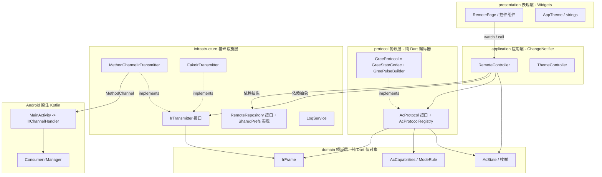
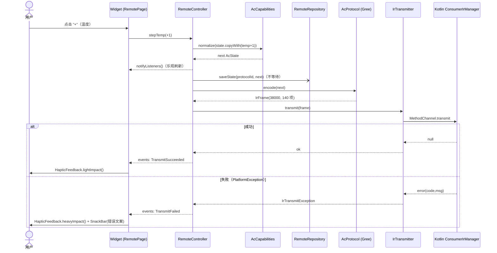

# flutter-aircon-remote 架构设计

> 状态：设计稿 v1（对应首个版本 0.1.0）。本文档是实现（Codex）的唯一依据；
> 文中类/文件/常量名即最终命名，代码标识符一律英文，说明为中文。
> 参考资料：`/workspace/refs/irremote/ir_Gree.{h,cpp}`、`ir_Gree_test.cpp`（IRremoteESP8266），
> 以及同作者的 `flutter-snake / tetris / music / bilibili-downloader-d4-qwen-code`。

---

## 1. 目标、非目标与约束

### 1.1 目标
- Android 专用 Flutter 应用，使用手机内置红外发射器（`android.hardware.ConsumerIrManager`）充当空调遥控器。
- 首个品牌：格力 Gree（YAW1F / YBOFB 协议，来自 IRremoteESP8266）。
- 功能：电源、模式（自动/制冷/除湿/送风/制热）、温度 16–30 °C、风速（自动/1/2/3 + 强劲 turbo）、
  垂直扫风（自动/关/固定位置）、附加项（灯光 light、换气/防霉 x-fan、睡眠 sleep、温度显示；健康 health 见 §5.3）。
- **每次按键发送完整状态**（空调 IR 协议是有状态的）。
- 状态跨启动持久化（`shared_preferences`）。
- 设备无红外发射器时给出友好提示，而不是崩溃或静默失败。
- 可扩展到其他品牌（Midea、Haier、Daikin…）：新增品牌 = 新增一个协议实现 + 注册，UI 零改动。
- 协议层为纯 Dart，可在无设备环境下 100% 单元测试，并对照 IRremoteESP8266 已知正确的字节向量。

### 1.2 非目标（0.1.0 不做）
- iOS / Windows / Web / 桌面；多设备/多房间配置档案；红外学习（接收）。
- 定时器（timer）、华氏度、Wi-Fi 位、I-Feel、Econo 位、水平扫风：协议里固定写 0（见 §5.3）。
- 读取空调真实状态（红外单向，无反馈；界面显示的是“假定状态”）。
- 国际化：仅简体中文，字符串集中在 `presentation/strings.dart`，日后可替换为 l10n。
- 外接红外设备（USB/音频口）。

### 1.3 工程约束（与参考项目一致）
| 项 | 值 |
|---|---|
| Flutter / Dart | 3.47.7 / `sdk: '>=3.13.5 <4.0.0'` |
| 状态管理 | `provider 6.1.5+1`（`ChangeNotifier`） |
| 持久化 | `shared_preferences 2.5.5` |
| 日志落盘 | `path_provider 2.1.5` + `path 1.9.1` |
| Lint | `flutter_lints 6.0.0`，`analysis_options.yaml` 直接沿用 flutter-snake 的规则集 |
| Android | compileSdk/targetSdk **37**（Android 17），minSdk **35**，仅 `arm64-v8a` |
| 构建链 | AGP 9.2.1、Gradle 9.5.1、Kotlin 2.3.21、Java 21，Groovy `build.gradle`（非 KTS） |
| 包名 / 项目名 | `com.example.flutter_aircon_remote` / `flutter_aircon_remote` |
| 版本 | `0.1.0`（`pubspec.yaml` 与 `AppConstants.version` 同步） |
| 文档 | `plan.md`（版本规划，由实现者创建并维护）、`prompt.md`（若存在，禁止修改） |
| 代码量 | 手写 Dart + Kotlin < 10000 行（预计 ~3000 行含测试） |

---

## 2. 分层架构



**依赖规则（必须遵守，由 `test/architecture_test.dart` 以 import 扫描方式强制）**
1. `domain` 不依赖任何其他层，也不 import `package:flutter`（纯 Dart，`dart:convert` 除外）。
2. `protocol` 只依赖 `domain`；不得 import `flutter`、`dart:io`、platform channel。
3. `infrastructure` 只依赖 `domain`（用到 `IrFrame`/`AcState`）与平台 API；不得依赖 `protocol` / `application`。
4. `application` 依赖 `domain`、`protocol` 接口、`infrastructure` **接口**；不 import `package:flutter/material.dart`
   （可 import `package:flutter/foundation.dart` 取 `ChangeNotifier`）。
5. `presentation` 只依赖 `application` 与 `domain`（读取枚举/能力）；不得直接触碰 `protocol` 具体类或 `infrastructure`
   （`DiagnosticsSheet` 经 `RemoteController` 暴露的 `logSnapshot()` 取日志，不直接 import `LogService`）。
6. 依赖注入集中在 `main.dart`（composition root）；所有具体实现在此装配，其余位置只见接口。

数据流：用户操作 → `RemoteController` 修改 `AcState`（经 `AcCapabilities.normalize`）→ 持久化 →
`AcProtocol.encode` 得到 `IrFrame` → `IrTransmitter.transmit` → Kotlin `ConsumerIrManager.transmit`。

---

## 3. 目录与文件布局

### 3.1 `lib/`
```
lib/
├─ main.dart                              # composition root：初始化日志、装配依赖、runApp
├─ app.dart                               # AircondRemoteApp：MultiProvider + MaterialApp(theme/darkTheme)
├─ core/
│  └─ constants.dart                      # AppConstants { appName, version='0.1.0', irChannelName, prefsKeys }
├─ domain/
│  ├─ ac_enums.dart                       # AcMode, FanSpeed, VerticalSwing, TempDisplay, AcFeature
│  ├─ ac_state.dart                       # AcState 不可变值对象 + JSON
│  ├─ ac_capabilities.dart                # AcCapabilities, ModeRule, normalize()
│  └─ ir_frame.dart                       # IrFrame：carrierHz + patternMicros（+ 校验）
├─ protocol/
│  ├─ ac_protocol.dart                    # abstract interface class AcProtocol
│  ├─ protocol_registry.dart              # AcProtocolRegistry（品牌/型号列表、byId）
│  ├─ pulse/
│  │  └─ pulse_timing.dart                # PulseTimings + appendBitsLsbFirst（可复用于其他品牌）
│  └─ gree/
│     ├─ gree_constants.dart              # 位域位置、枚举数值、时序常量
│     ├─ gree_state_codec.dart            # AcState <-> 8 字节（含校验和）
│     ├─ gree_pulse_builder.dart          # 8 字节 -> List<int> 微秒序列（含中间 footer 与 gap）
│     └─ gree_protocol.dart               # GreeProtocol(GreeModel)：组合 codec + builder + capabilities
├─ infrastructure/
│  ├─ ir/
│  │  ├─ ir_transmitter.dart              # abstract IrTransmitter, IrTransmitException, IrErrorCode, CarrierRange
│  │  ├─ method_channel_ir_transmitter.dart
│  │  └─ fake_ir_transmitter.dart         # 记录发送帧，可注入失败；测试与 --dart-define=FAKE_IR=true 使用
│  ├─ persistence/
│  │  ├─ remote_repository.dart           # abstract RemoteRepository + PersistedRemote
│  │  └─ shared_prefs_remote_repository.dart
│  └─ logging/
│     └─ log_service.dart                 # 按日落盘日志，风格同 flutter-snake 的 LogService
├─ application/
│  ├─ remote_controller.dart              # RemoteController：状态、协议、IR 可用性、发送串行化
│  ├─ remote_event.dart                   # sealed RemoteEvent（一次性事件：发送成功/失败）
│  └─ theme_controller.dart               # ThemeController：主题模式名持久化（String，不含 Flutter 类型）
└─ presentation/
   ├─ strings.dart                        # 所有中文文案常量
   ├─ theme/app_theme.dart                # 亮/暗 ThemeData（Material 3, seedColor）
   ├─ pages/
   │  ├─ remote_page.dart                 # 唯一主界面
   │  └─ diagnostics_sheet.dart           # 底部弹窗：版本、日志路径、最近日志、复制
   └─ widgets/
      ├─ no_ir_banner.dart
      ├─ brand_selector.dart              # 品牌/型号下拉
      ├─ power_button.dart
      ├─ temperature_display.dart         # 大号温度 + (−/+) 按钮，长按连发
      ├─ mode_selector.dart               # SegmentedButton，选项由 capabilities 决定
      ├─ fan_selector.dart
      ├─ swing_selector.dart
      └─ feature_toggles.dart             # FilterChip 组：turbo/light/health/xfan/sleep + tempDisplay
```

### 3.2 `test/`
```
test/
├─ support/
│  ├─ gree_vectors.dart                   # 从 ir_Gree_test.cpp 摘取的已知字节向量（见 §5.6）
│  ├─ in_memory_remote_repository.dart
│  └─ pump_app.dart                       # widget 测试装配
├─ domain/
│  ├─ ac_state_test.dart                  # copyWith / == / JSON 往返 / 容错解析
│  └─ ac_capabilities_test.dart           # normalize：夹取、模式约束、幂等
├─ protocol/
│  ├─ pulse_timing_test.dart
│  ├─ gree_checksum_test.dart
│  ├─ gree_state_codec_test.dart          # 对照已知向量，encode + decode
│  ├─ gree_pulse_builder_test.dart
│  ├─ gree_protocol_test.dart             # 端到端 AcState -> IrFrame
│  └─ protocol_registry_test.dart
├─ infrastructure/
│  ├─ method_channel_ir_transmitter_test.dart   # mock MethodChannel，错误码映射
│  └─ shared_prefs_remote_repository_test.dart  # SharedPreferences.setMockInitialValues
├─ application/
│  └─ remote_controller_test.dart         # FakeIrTransmitter + InMemory repo
├─ presentation/
│  └─ remote_page_test.dart               # 无 IR 横幅、控件随 capabilities 显隐/禁用
├─ architecture_test.dart                 # 扫描 lib/ 的 import，校验 §2 依赖规则
└─ version_test.dart                      # AppConstants.version == pubspec.yaml 的 version
```

### 3.3 关键接口签名（仅接口，实现由 Codex 完成）

```dart
// ---- domain/ac_enums.dart ----
enum AcMode { auto, cool, dry, fan, heat }
enum FanSpeed { auto, low, medium, high }                    // turbo 是独立开关，不在此枚举
enum VerticalSwing { off, auto, highest, high, middle, low, lowest }
enum TempDisplay { off, setpoint, indoor, outdoor }
enum AcFeature { turbo, light, health, xfan, sleep, tempDisplay }

// ---- domain/ir_frame.dart ----
final class IrFrame {
  const IrFrame({required this.carrierHz, required this.patternMicros, this.debugHex = ''});
  final int carrierHz;               // 例如 38000
  final List<int> patternMicros;     // [mark, space, mark, space, ...]，单位 µs，全部 > 0
  final String debugHex;             // 仅用于日志，如 "19 0A 60 50 02 23 00 F0"
  int get totalMicros;
  void validate({int maxMicros = 2000000, int maxEntries = 1000}); // 违反抛 ArgumentError
}

// ---- protocol/ac_protocol.dart ----
abstract interface class AcProtocol {
  String get id;            // 全局唯一，如 'gree.yaw1f'（持久化用，发布后不可改名）
  String get brandId;       // 'gree'
  String get brandName;     // '格力 Gree'
  String get modelName;     // 'YAW1F'
  AcCapabilities get capabilities;
  AcState get defaultState;
  IrFrame encode(AcState state);   // 内部先 capabilities.normalize(state)；纯函数，无副作用
}

// ---- protocol/protocol_registry.dart ----
class AcProtocolRegistry {
  AcProtocolRegistry(List<AcProtocol> protocols);   // id 重复 → StateError；列表为空 → StateError
  List<AcProtocol> get all;
  List<String> get brandIds;                         // 保持注册顺序
  List<AcProtocol> modelsOf(String brandId);
  AcProtocol? byId(String id);
  AcProtocol get fallback;                           // 第一个注册项（gree.yaw1f）
}

// ---- infrastructure/ir/ir_transmitter.dart ----
enum IrErrorCode { noIrEmitter, invalidArgument, patternTooLong,
                   unsupportedFrequency, permissionDenied, transmitFailed, platform }
class IrTransmitException implements Exception {
  const IrTransmitException(this.code, this.message);
  final IrErrorCode code; final String message;
}
class CarrierRange { const CarrierRange(this.minHz, this.maxHz); final int minHz, maxHz; }
abstract interface class IrTransmitter {
  Future<bool> hasIrEmitter();
  Future<List<CarrierRange>> getCarrierFrequencies();   // 无发射器返回空列表
  Future<void> transmit(IrFrame frame);                 // 失败抛 IrTransmitException
}

// ---- infrastructure/persistence/remote_repository.dart ----
// 不引入 Flutter 类型：主题模式以 String（'system' | 'light' | 'dark'）读写，ThemeController 负责与 ThemeMode 互转。
class PersistedRemote {
  const PersistedRemote({this.protocolId, this.states = const {}, this.themeModeName});
  final String? protocolId;
  final Map<String, AcState> states;      // key = protocolId
  final String? themeModeName;
}
abstract interface class RemoteRepository {
  Future<PersistedRemote> load();         // 任何损坏数据 → 对应字段缺省，不抛
  Future<void> saveState(String protocolId, AcState state);
  Future<void> saveProtocolId(String protocolId);
  Future<void> saveThemeModeName(String name);
}

// ---- application/remote_controller.dart ----
enum IrAvailability { unknown, available, unavailable }
class RemoteController extends ChangeNotifier {
  RemoteController({required AcProtocolRegistry registry, required IrTransmitter transmitter,
                    required RemoteRepository repository});
  AcProtocolRegistry get registry;
  AcProtocol get protocol;
  AcState get state;
  AcCapabilities get capabilities => protocol.capabilities;
  IrAvailability get irAvailability;
  bool get isSending;
  Stream<RemoteEvent> get events;                       // broadcast
  Future<void> init();                                  // 读持久化 + 探测 IR；失败回落默认值；不发码
  Future<void> update(AcState Function(AcState s) mutate);  // 通用入口：normalize→notify→persist→send
  Future<void> setProtocol(String protocolId);          // 切换品牌/型号：加载该协议的已存状态，不发码
  Future<void> recheckIr();                             // 横幅“重新检测”
  // 以下均为 update 的语法糖：
  Future<void> togglePower();
  Future<void> setMode(AcMode m);        Future<void> stepTemp(int delta);
  Future<void> setFan(FanSpeed f);       Future<void> setSwing(VerticalSwing s);
  Future<void> toggleFeature(AcFeature f);   Future<void> setTempDisplay(TempDisplay d);
  List<String> logSnapshot([int n = 200]);  String logFilePath();   // 诊断页用，转发 LogService
}
sealed class RemoteEvent {}
final class TransmitSucceeded extends RemoteEvent {}
final class TransmitFailed extends RemoteEvent {
  TransmitFailed(this.code, this.message);
  final IrErrorCode code; final String message;
}
```

---

## 4. 领域状态模型

### 4.1 `AcState`（不可变、值相等）
| 字段 | 类型 | 取值/范围 | 默认 |
|---|---|---|---|
| `power` | `bool` | | `false` |
| `mode` | `AcMode` | auto/cool/dry/fan/heat | `cool` |
| `targetTempC` | `int` | `capabilities.minTempC..maxTempC`（Gree 16..30） | `26` |
| `fan` | `FanSpeed` | auto/low/medium/high | `auto` |
| `turbo` | `bool` | 强劲（独立于 fan） | `false` |
| `verticalSwing` | `VerticalSwing` | off/auto/highest/high/middle/low/lowest | `off` |
| `light` | `bool` | 机身显示灯 | `true` |
| `health` | `bool` | 健康/负离子（能力位，Gree 0.1.0 不支持，见 §5.3） | `false` |
| `xfan` | `bool` | 换气/防霉（关机后吹干） | `false` |
| `sleep` | `bool` | 睡眠 | `false` |
| `tempDisplay` | `TempDisplay` | off/setpoint/indoor/outdoor | `off` |

```dart
@immutable
final class AcState {
  const AcState({required this.power, required this.mode, required this.targetTempC,
    required this.fan, required this.turbo, required this.verticalSwing, required this.light,
    required this.health, required this.xfan, required this.sleep, required this.tempDisplay});
  const AcState.initial();                       // 即上表默认值
  AcState copyWith({bool? power, AcMode? mode, int? targetTempC, FanSpeed? fan, bool? turbo,
    VerticalSwing? verticalSwing, bool? light, bool? health, bool? xfan, bool? sleep,
    TempDisplay? tempDisplay});                  // 所有字段非空，故无需 sentinel
  Map<String, Object?> toJson();                 // {'v':1,'power':..,'mode':'cool',...} 枚举用 name
  factory AcState.fromJson(Map<String, Object?> json); // 容错：缺失/未知枚举名/类型错误 → 该字段取默认值；不抛异常
  // == / hashCode / toString 基于全部字段
}
```
JSON 带 `v: 1` schema 版本，便于日后迁移；`fromJson` 永不抛出（损坏数据回落默认值，由调用方记 WARN）。
`AcState` 本身**不做**范围校验（可构造任意 `targetTempC`），合法性统一由 `AcCapabilities.normalize` 保证。

### 4.2 品牌无关能力模型 `AcCapabilities`
```dart
class ModeRule {                                  // 每个模式的约束
  const ModeRule({this.fixedTempC, this.tempEditable = true, this.fixedFan,
                  this.allowedFeatures = const {}});
  final int? fixedTempC;          // 非空：该模式温度被锁定（Gree auto = 25）
  final bool tempEditable;        // false：UI 禁用温度按钮（fan 模式；沿用 state 中的值）
  final FanSpeed? fixedFan;       // 非空：风速被锁定（Gree dry = low）
  final Set<AcFeature> allowedFeatures;
}
class AcCapabilities {
  const AcCapabilities({required this.minTempC, required this.maxTempC,
    required this.modes, required this.fanSpeeds, required this.verticalSwings,
    required this.tempDisplays, required this.features, required this.modeRules});
  final int minTempC, maxTempC;
  final List<AcMode> modes;                 // 决定 ModeSelector 的选项
  final List<FanSpeed> fanSpeeds;
  final List<VerticalSwing> verticalSwings; // 空列表 = 不显示扫风控件
  final List<TempDisplay> tempDisplays;     // 至少含 off
  final Set<AcFeature> features;            // 协议整体支持的附加项（UI 显隐）；tempDisplay 是否显示也由此决定
  final Map<AcMode, ModeRule> modeRules;    // 必须覆盖 modes 中的每一项
  AcState normalize(AcState s);             // 纯函数，幂等
  bool isFeatureEnabled(AcState s, AcFeature f);   // f ∈ features ∩ modeRules[s.mode].allowedFeatures（UI 可点击性）
  bool canEditTemp(AcState s);  bool canEditFan(AcState s);
}
```
**`normalize` 规则（按序执行，幂等；`power` 不受影响）**
1. 枚举越权：`mode ∉ modes` → `modes.first`；`fan ∉ fanSpeeds` → `fanSpeeds.first`；
   `verticalSwing ∉ verticalSwings` → `off`；`tempDisplay ∉ tempDisplays` → `off`。
2. 温度夹取到 `[minTempC, maxTempC]`。
3. 应用 `modeRules[mode]`：`fixedTempC != null` → 覆盖温度；`fixedFan != null` → 覆盖风速。
4. 特性裁剪：对每个 `AcFeature f`，若 `f ∉ features ∩ rule.allowedFeatures`，置为关闭值
   （bool → `false`，`tempDisplay` → `off`）。
   注意：切换模式会丢弃不被新模式允许的开关，再切回不恢复（可接受，保持逻辑简单；README 说明）。

**Gree 的具体能力（`GreeProtocol.capabilities`）**
| 模式 | 温度 | 风速 | 允许特性 |
|---|---|---|---|
| auto | 锁定 25 | 任意 | light, sleep, tempDisplay |
| cool | 16–30 | 任意 | turbo, light, xfan, sleep, tempDisplay |
| dry | 16–30 | 锁定 low（IRremote：`setFan` 在 Dry 下强制 1） | light, xfan, sleep, tempDisplay |
| fan | 不可调（沿用 state 值） | 任意 | light, tempDisplay |
| heat | 16–30 | 任意 | turbo, light, sleep, tempDisplay |

`features` 整体 = {turbo, light, xfan, sleep, tempDisplay}（**不含 health**，见 §5.3）；
`verticalSwings` = 全部 7 项；`tempDisplays` = {off, setpoint, indoor, outdoor}；`fanSpeeds` = 全部 4 项。
上表中 turbo/xfan/sleep 的模式限制来自实际遥控器行为的保守取值，IRremoteESP8266 本身只强制 Auto 锁温与 Dry 锁风速；
这些规则集中在 `GreeProtocol` 的一张表里，后续按实测放宽只需改表和对应测试。

---

## 5. 协议层

### 5.1 管线
```
AcState --normalize--> AcState' --GreeStateCodec.encode--> Uint8List(8) [含校验和]
        --GreePulseBuilder.build--> List<int> patternMicros --> IrFrame(carrierHz: 38000, ..., debugHex)
```
`GreeProtocol` 仅做组合，构造参数 `GreeModel { yaw1f, ybofb }`（只影响 ModelA 位）。注册为两个协议项：
`gree.yaw1f`（默认，modelName `YAW1F`）与 `gree.ybofb`（`YBOFB`），同属品牌 `gree`。

```dart
// gree_state_codec.dart —— 纯函数，无时序知识
enum GreeModel { yaw1f, ybofb }
final class GreeStateCodec {
  const GreeStateCodec(this.model);
  final GreeModel model;
  Uint8List encode(AcState normalized);          // 长度恒为 8，已写入校验和
  AcState decode(Uint8List bytes);               // 仅测试/调试用（把已知向量解回 AcState）；忽略不支持的位
  static int checksum(List<int> bytes);          // 返回 0..15
  static bool isValid(List<int> bytes);          // 长度 8 且 bytes[7] 高半字节 == checksum
}
// gree_pulse_builder.dart —— 纯函数，无状态语义
final class GreePulseBuilder {
  const GreePulseBuilder();
  List<int> build(Uint8List bytes);              // 长度必须为 8，否则 ArgumentError
}
// pulse/pulse_timing.dart —— 可被其他品牌复用
final class PulseTimings {
  const PulseTimings({required this.headerMark, required this.headerSpace, required this.bitMark,
                      required this.oneSpace, required this.zeroSpace, required this.gapSpace});
}
void appendBitsLsbFirst(List<int> out, int value, int bitCount, PulseTimings t); // 每位追加 mark+space
```

### 5.2 时序与帧结构（对应 `IRsend::sendGree(const uint8_t data[], ...)`）
常量（`gree_constants.dart`）：`hdrMark=9000, hdrSpace=4500, bitMark=620, oneSpace=1600, zeroSpace=540, msgSpace=19980, carrierHz=38000, blockFooter=0b010（3 位）`。

位序：**每个字节 LSB 先发**；字节顺序 byte0→byte7；footer 的 3 位按 LSB 先发为 0,1,0（回文，无歧义）。

```
[hdrMark 9000][hdrSpace 4500]
 byte0..byte3 : 32 位，每位 [620][540 或 1600]（0→540，1→1600）
 footer 3 位  : 0,1,0 → [620][540] [620][1600] [620][540]
 [bitMark 620][msgSpace 19980]            ← 块 1 结束的 gap
 byte4..byte7 : 32 位
 [bitMark 620][msgSpace 19980]            ← 消息结束 footer
```
条目数 = 2 + 64 + 6 + 2 + 64 + 2 = **140**（偶数，mark 起、space 终）。
下标：header `p[0..1]`；块 1 `p[2..65]`；footer 位 `p[66..71]`；块间 mark+gap `p[72..73]`；块 2 `p[74..137]`；结尾 mark+gap `p[138..139]`。
总时长约 0.15–0.21 s，远小于 2 s 上限。
默认**只发送一次**（IRremote 的 `kGreeDefaultRepeat = 0`，与真实遥控器一致）；不引入 repeat 参数，保持 `IrFrame` 简单。

### 5.3 字节/位映射表（LSB = bit0；与 `union GreeProtocol` 位域一致）
| Byte | 位 | 字段 | AcState 来源 / 取值 |
|---|---|---|---|
| 0 | 0–2 | Mode | auto=0, cool=1, dry=2, fan=3, heat=4（5=Econo 不使用） |
| 0 | 3 | Power | `power` |
| 0 | 4–5 | Fan | auto=0, low=1, medium=2, high=3 |
| 0 | 6 | SwingAuto | `verticalSwing == auto` 时为 1，其余 0 |
| 0 | 7 | Sleep | `sleep` |
| 1 | 0–3 | Temp | `targetTempC − 16`（0..14） |
| 1 | 4–7 | Timer* | 固定 0（无定时） |
| 2 | 0–3 | TimerHours | 固定 0 |
| 2 | 4 | Turbo | `turbo` |
| 2 | 5 | Light | `light` |
| 2 | 6 | ModelA | `power && model == yaw1f`（**关机时为 0**，见 Issue814 向量） |
| 2 | 7 | Xfan | `xfan` |
| 3 | 0–1 | — | 0 |
| 3 | 2 | TempExtraDegreeF | 0 |
| 3 | 3 | UseFahrenheit | 0（仅摄氏） |
| 3 | 4–7 | unknown1 | 固定 `0b0101`（字节 = 0x50） |
| 4 | 0–3 | SwingV | off=0（Last pos）, auto=1, highest=2, high=3, middle=4, low=5, lowest=6 |
| 4 | 4–6 | SwingH | 0（水平扫风不做） |
| 5 | 0–1 | DisplayTemp | off=0, setpoint=1, indoor=2, outdoor=3 |
| 5 | 2 | IFeel | 0 |
| 5 | 3–5 | unknown2 | 固定 `0b100`（该字节基准值 0x20） |
| 5 | 6 | WiFi | 0 |
| 6 | 0–7 | — | 0 |
| 7 | 2 | Econo | 0 |
| 7 | 4–7 | Sum | 校验和（见下） |

其余未列位均为 0。**基准帧**（IRremote `stateReset`）：`00 09 20 50 00 20 00 50`（关机/自动/25 °C/灯亮）。

**健康（health）**：IRremoteESP8266 的 Gree 位域**没有**文档化的 health/ionizer 位，本项目不得臆造。
0.1.0：`AcState.health` 与 `AcFeature.health` 保留在领域层，Gree 能力集不声明该特性（UI 自动不显示，编码不写任何位）。
若日后拿到经实机验证的位位置，只需在 `GreeStateCodec` 增加一行、把 `health` 加入 `features` 与 `modeRules`，并补向量测试。

**校验和**（Kelvinator `calcBlockChecksum`，Gree 复用；该函数不在参考文件中，以此处为准）：
```
sum = 10
for i in 0..3: sum += bytes[i] & 0x0F        // 前 4 字节的低半字节
for i in 4..6: sum += bytes[i] >> 4          // byte4..6 的高半字节
checksum = sum & 0x0F                        // 写入 bytes[7] 高 4 位：bytes[7] = (checksum << 4) | (bytes[7] & 0x0F)
```
手工验证：`00 09 20 50 00 20 00 50` → 10+0+9+0+0+0+2+0=21 → 5 ✓；
`19 0A 60 50 02 23 00 F0` → 10+9+10+0+0+0+2+0=31 → 0xF ✓；
`59 07 60 50 01 20 00 C0` → 10+9+7+0+0+0+2+0=28 → 0xC ✓。

### 5.4 YAW1F 与 YBOFB 的差异
仅 byte2 bit6（ModelA）：YAW1F 开机时为 1，YBOFB 恒为 0；关机时两者都为 0。其他位相同。

### 5.5 `GreeProtocol` 行为摘要
`encode(s)`：`n = capabilities.normalize(s)` → `bytes = codec.encode(n)` → `pattern = builder.build(bytes)` →
`IrFrame(carrierHz: 38000, patternMicros: pattern, debugHex: hex(bytes))`，并调用 `frame.validate()`。
`defaultState` = `capabilities.normalize(const AcState.initial())`。

### 5.6 测试策略（必须全部通过，且不依赖设备）
`test/support/gree_vectors.dart` 提供 `class GreeVector { name, model, AcState state, List<int> bytes }`，
全部取自 `ir_Gree_test.cpp`：

| 名称 | model | 字节 | 对应 AcState | 出处 |
|---|---|---|---|---|
| baseline-off | yaw1f | `00 09 20 50 00 20 00 50` | power off, auto, 25, fan auto, light on, swing off | NormalSynthetic / stateReset |
| real-cool | yaw1f | `19 0A 60 50 02 23 00 F0` | on, cool, 26, fan low, light, swing highest, tempDisplay outdoor | NormalRealExample |
| on-yaw1f | yaw1f | `59 07 60 50 01 20 00 C0` | on, cool, 23, fan low, light, swing auto | Issue814Power |
| on-ybofb | ybofb | `59 07 20 50 01 20 00 C0` | 同上 | Issue814Power |
| off | yaw1f 与 ybofb | `51 07 20 50 01 20 00 40` | 同上但 power off | Issue814Power |
| heat-indoor | yaw1f | `4C 04 60 50 01 02 00 A0` | on, heat, 20, fan auto, light, swing auto, tempDisplay indoor | DisplayTempSource |

> 向量来自参考实现的“已知正确”数据：若某向量被本文 normalize 规则（§4.2）改写而无法复现，**以向量为准调整规则表**，不得改向量。
> （例：real-cool 为制冷模式带 tempDisplay=outdoor，规则表已允许。）

测试清单：
1. **codec**：对每个向量 `encode(state) == bytes`、`decode(bytes) == state`（往返）；
   另对 mode×fan×温度×若干开关组合做抽样性质断言：校验和合法、byte3 == 0x50、`byte5 & 0x38 == 0x20`、保留位为 0。
2. **checksum**：向量 `isValid` 为真；翻转任一数据位 → 非法；长度≠8 → false。
3. **normalize**：Auto 下温度恒 25；Dry 下风速恒 low；Fan 模式下 turbo/xfan/sleep 被裁剪；温度 10 → 16、40 → 30；幂等（`n(n(s)) == n(s)`）；`power` 不变。
4. **pulse builder**：长度 140；`p[0]==9000, p[1]==4500`；偶数下标（除 0）全为 620，奇数下标（除 1）∈ {540, 1600, 19980}；
   `p[66..71] == [620,540,620,1600,620,540]`；`p[72]==620 && p[73]==19980`；`p[138]==620 && p[139]==19980`；
   测试内自带 pattern→bytes 解码器（1600→1、540→0，跳过 footer）还原出原 8 字节；总时长 < 2 s；输入长度≠8 抛 `ArgumentError`。
5. **protocol**：`GreeProtocol.encode(AcState.initial())` 的 carrier 为 38000、`validate()` 不抛、`debugHex` 格式为空格分隔大写两位十六进制。
6. **registry**：id 唯一；`byId('gree.yaw1f')` 命中；未知 id → null；`modelsOf('gree')` 长度 2；重复 id 抛 `StateError`。
7. **MethodChannelIrTransmitter**：用 `TestDefaultBinaryMessengerBinding` mock channel，校验参数结构与各错误码 → `IrErrorCode` 映射。
8. **controller**：见 §8。**widget**：见 §9。

---

## 6. 平台通道契约

- **Channel 名**：`com.example.flutter_aircon_remote/ir`（`AppConstants.irChannelName`；Kotlin 侧另有同值常量，测试断言两处一致）。
- `MethodChannel`，标准编解码。

| 方法 | 参数 | 返回 | 说明 |
|---|---|---|---|
| `hasIrEmitter` | — | `bool` | `getSystemService(CONSUMER_IR_SERVICE)?.hasIrEmitter() == true`；不抛错 |
| `getCarrierFrequencies` | — | `List<Map{'min':int,'max':int}>` | 无发射器/不支持返回空列表 |
| `transmit` | `{'carrierHz': int, 'pattern': List<int>}` | `null` | 成功即返回；失败返回 PlatformException |

**错误码（`PlatformException.code`）→ `IrErrorCode`**

| code | `IrErrorCode` | 触发条件 |
|---|---|---|
| `NO_IR_EMITTER` | `noIrEmitter` | 服务为空或 `hasIrEmitter()==false` |
| `INVALID_ARGUMENT` | `invalidArgument` | 参数缺失/类型错、`carrierHz <= 0`、pattern 为空或含 ≤0 的元素 |
| `PATTERN_TOO_LONG` | `patternTooLong` | 条目数 > 1000 或总时长 ≥ 2 000 000 µs |
| `UNSUPPORTED_FREQUENCY` | `unsupportedFrequency` | `getCarrierFrequencies()` 非空且无任何区间包含 `carrierHz` |
| `PERMISSION_DENIED` | `permissionDenied` | 捕获 `SecurityException`（权限被 OEM 撤销等） |
| `TRANSMIT_FAILED` | `transmitFailed` | 其他 `Exception`（message 带异常信息） |
| 其他 / `MissingPluginException` | `platform` | Dart 侧兜底映射 |

Dart 侧 `MethodChannelIrTransmitter`：`hasIrEmitter` 遇 `MissingPluginException`/`PlatformException` 返回 `false` 并记 WARN；
`transmit` 先 `frame.validate()`（`ArgumentError` 转为 `IrTransmitException(invalidArgument/patternTooLong)`），再
`invokeMethod<void>('transmit', {'carrierHz': ..., 'pattern': frame.patternMicros})`（Kotlin 收到 `List<Int>` → `toIntArray()`）。

**Kotlin 侧设计**（`android/app/src/main/kotlin/com/example/flutter_aircon_remote/`）
- `MainActivity.kt`：`class MainActivity : FlutterActivity()`，`configureFlutterEngine(engine)` 中
  先 `super.configureFlutterEngine(engine)`，再 `IrChannelHandler(applicationContext).register(engine.dartExecutor.binaryMessenger)`；`onDestroy` 调用 `handler.dispose()`。
- `IrChannelHandler.kt`：实现 `MethodChannel.MethodCallHandler`；持有 `ConsumerIrManager?`（`getSystemService(Context.CONSUMER_IR_SERVICE)`）。
  请求校验抽成无 Android 依赖的纯函数（`IrRequestValidator`，便于 JVM 单测，可选）。
  `transmit` 在**单线程 Executor** 上执行（部分 OEM 的 `transmit` 会阻塞至波形发完），结果经 `Handler(Looper.getMainLooper())` 回主线程再 `result.success/error`；
  串行执行保证两次发送不重叠。`dispose()` 中 `executor.shutdown()`。
- **ConsumerIrManager 约束**：`transmit(int carrierFrequency, int[] pattern)`，pattern 为 mark/space 交替的 µs 整数数组（首元素为 mark）；
  一次波形总时长必须小于 2 s（本项目 Gree ≈ 0.2 s）；频率须在 `getCarrierFrequencies()` 区间内。
- **清单**（`android/app/src/main/AndroidManifest.xml`）：
  ```xml
  <uses-permission android:name="android.permission.TRANSMIT_IR" />
  <uses-feature android:name="android.hardware.consumerir" android:required="false" />
  ```
  `TRANSMIT_IR` 为普通权限（安装时授予，无运行时弹窗）。`required="false"` 使无红外设备也可安装并显示友好提示。

---

## 7. 品牌注册与扩展

`main.dart` 中的唯一注册点：
```dart
final registry = AcProtocolRegistry([
  GreeProtocol(GreeModel.yaw1f),   // 第一个 = fallback / 默认
  GreeProtocol(GreeModel.ybofb),
]);
```
**新增品牌（如 Midea）步骤**
1. 在 `lib/protocol/midea/` 新建 `midea_constants.dart`、`midea_state_codec.dart`（AcState→字节）、
   `midea_pulse_builder.dart`（复用 `pulse/pulse_timing.dart`）、`midea_protocol.dart`（`implements AcProtocol`，声明 `id='midea.default'` 与 `AcCapabilities`）。
2. 在 `main.dart` 的列表加一行 `MideaProtocol()`。
3. 新增 `test/protocol/midea_*_test.dart`，使用 IRremoteESP8266 对应 `ir_<Brand>_test.cpp` 的向量。
4. **不修改** `domain/`、`application/`、`presentation/`、`infrastructure/`：UI 完全由 `AcCapabilities` 驱动。
   若新品牌需要新的领域概念（如水平扫风），先在 `AcState`/`AcFeature` 增字段（bump JSON `v`，`fromJson` 保持向后兼容），再让相关协议声明能力。

`AcProtocol.id` 一经发布不可改（它是持久化键的一部分）。

---

## 8. 状态管理与持久化流程

### 8.1 持久化（`SharedPrefsRemoteRepository`）
| key | 值 |
|---|---|
| `remote.protocolId` | `String`，当前协议 id |
| `remote.state.<protocolId>` | `String`，`jsonEncode(AcState.toJson())` |
| `ui.themeMode` | `String`，`system` / `light` / `dark` |

按协议分别存状态，切换品牌/型号时各自保留。`load()` 通过 `prefs.getKeys()` 收集 `remote.state.` 前缀项。
读取失败（缺失/JSON 损坏/未知 id）→ 回落默认并记 WARN，**不弹错误**。key 常量放在 `AppConstants`。

### 8.2 `RemoteController` 关键行为
- `init()`：`repository.load()` → 选择协议（`byId(saved) ?? registry.fallback`）→ 取该协议已存状态并 `normalize`（无则 `defaultState`）→
  `transmitter.hasIrEmitter()` 设置 `irAvailability` → `notifyListeners()`。**启动时不发送红外**。
- `update(mutate)`：
  1. 若 `irAvailability == unavailable`：忽略（UI 已禁用控件，此为防御）。
  2. `next = capabilities.normalize(mutate(state))`；若 `next == state` 直接返回。
  3. `state = next; notifyListeners()`（乐观更新，UI 即时反馈）。
  4. `unawaited(repository.saveState(...))`（失败仅记 WARN）。
  5. 触发发送（见下）。
- **发送串行化 + 合并**：控制器持有 `_pending: AcState?` 与 `_sending` 标志。`_enqueueSend()` 设 `_pending = state`；若无发送在途则循环：
  取走 `_pending` → `protocol.encode` → `await transmitter.transmit(frame)` → 发布事件；直到 `_pending == null`。
  因为每帧都是**完整状态**，长按 +/- 连发时丢弃中间帧、只发最新态是安全的，并避免波形重叠与通道积压。
  `isSending` 反映循环是否在运行。
- `setProtocol(id)`：保存 id，加载该协议已存状态（无则默认）并 normalize，通知；**不自动发送**。
- 编码异常（理论上不会）捕获后发 `TransmitFailed(IrErrorCode.invalidArgument, …)`。
- `dispose()` 关闭事件流。

### 8.3 按键时序

`RemotePage` 在 `initState` 中订阅 `controller.events`（`dispose` 取消），将事件翻译为触觉反馈 + `ScaffoldMessenger` SnackBar。
成功事件仅触觉，不弹 SnackBar；失败 SnackBar 文案按 `IrErrorCode` 映射到 `strings.dart`。

`remote_controller_test.dart` 覆盖：init 不发码；按键后 `FakeIrTransmitter.sent.last` 的 `debugHex` 等于期望向量；
连续快速多次 `stepTemp` 只保证**最后一帧**为最新态且无并发 transmit；失败时发 `TransmitFailed` 且状态保留；
`unavailable` 时 `update` 不发码；`setProtocol` 状态隔离与持久化；损坏的持久化数据回落默认。

---

## 9. UI 设计

单页 `RemotePage`（`Scaffold`，Material 3，竖屏优先；宽屏下内容限宽 480 并居中）。

```
┌ AppBar: [品牌▼ 格力 Gree / YAW1F]            [☀/☾ 主题] [ⓘ 诊断] ┐
│ NoIrBanner（仅 unavailable 时显示，errorContainer 配色 + [重新检测]）│
│ ┌ 显示卡片 ───────────────────────────────┐                      │
│ │  制冷 · 风速自动 · 扫风关           [开/关指示] │                      │
│ │              26 °C                       │ ← 大号温度           │
│ │          [ −  ]       [ +  ]             │ ← 长按每 150 ms 连发  │
│ └──────────────────────────────────────┘                      │
│ [ 电源 ]  圆形大按钮，开=primary，关=surfaceVariant                  │
│ 模式   SegmentedButton: 自动 制冷 除湿 送风 制热                       │
│ 风速   SegmentedButton: 自动 1 2 3        (dry 下禁用，显示锁定为 1)   │
│ 扫风   ChoiceChip 组：关 自动 最上 上 中 下 最下                       │
│ 功能   FilterChip：强劲 灯光 换气 睡眠 ；温度显示 下拉(关/设定/室内/室外) │
└────────────────────────────────────────────────────────────┘
```
- 控件项来自 `capabilities`：`modes`、`fanSpeeds`、`verticalSwings`（空则隐藏整行）、`features`（不在集合内则不渲染该 chip，`health` 因此不显示）、
  `tempDisplays`（`tempDisplay ∉ features` 或仅一项时隐藏）；可点击性来自 `isFeatureEnabled / canEditTemp / canEditFan`（不可用 = 禁用态，不隐藏）。
- 关机状态：控件仍可操作（符合实体遥控器：先改参数再开机）。**每次按键都发送完整帧**（含 power=off），与 IRremote 行为一致；
  若不希望关机时改参数就发码，可在后续版本加设置开关（0.1.0 不做）。
- **无红外发射器**：`irAvailability == unavailable` → 顶部 `NoIrBanner`（文案：“此设备没有红外发射器，无法发送遥控信号”，
  附 [重新检测]），所有控件整体 `IgnorePointer` + 降低不透明度；品牌选择、主题、诊断入口仍可用。`unknown`（启动探测中）显示线性进度条。
- 主题：`ThemeController`（默认 `system`，AppBar 图标循环 system→light→dark，持久化）；
  `AppTheme.light/dark` 以同一 `seedColor`（建议 teal）经 `ColorScheme.fromSeed` 生成；文本不硬编码颜色。
- 无障碍：图标按钮有 `tooltip`/`Semantics`；点击目标 ≥ 48dp。
- 性能：各控件用 `context.select<RemoteController, …>` 精确订阅，避免整页重建。
- widget 测试：用 `FakeIrTransmitter(hasEmitter: false)` 断言横幅出现且控件不可点；有发射器时点击模式/温度后 `sent` 增加；Gree 下不渲染 health chip。

---

## 10. 日志、错误处理、构建与 CI

### 10.1 日志
- `LogService`（静态门面，风格同 flutter-snake）：`init()`、`info/warning/error(msg, [err, stack])`、`getRecentLogs([n])`、`getLogFilePath()`。
  文件：`<getApplicationSupportDirectory()>/logs/app_yyyyMMdd.log`，内存环形缓冲 1000 行；写文件失败静默吞掉；启动时清理 7 天前的旧日志。
  `init` 之前调用静态方法为 no-op（测试中无需初始化）。
- `main.dart`：`WidgetsFlutterBinding.ensureInitialized()` → `await LogService.init()` → 装配 → `runApp`；
  `FlutterError.onError` 与 `PlatformDispatcher.instance.onError` 转发到 `LogService.error`。
- 记录点：启动/版本；IR 探测结果；每次发送 `protocol.id | debugHex | patternLength | totalMs`；发送结果与错误码；持久化读写失败；协议切换。
- `protocol/` 与 `domain/` **不记日志**（保持纯净），由 `RemoteController` 记录。
- `DiagnosticsSheet`：展示版本、日志文件路径、最近 200 行（可复制），用户反馈问题时使用。

### 10.2 错误处理原则
| 场景 | 处理 |
|---|---|
| 无 IR 发射器 | 横幅 + 禁用控件，不抛异常 |
| 发送失败（`IrTransmitException`） | 记 ERROR；SnackBar（含错误类别文案）+ 重触觉；状态**保留**（用户可再次点击重发） |
| 持久化失败/数据损坏 | 记 WARN，回落默认，不打扰用户 |
| 编码/校验失败（程序缺陷） | 记 ERROR，发 `TransmitFailed`，不崩溃 |
| 未捕获异常 | 全局钩子写日志 |

### 10.3 Android 构建文件
从 `/workspace/refs/flutter-snake/android` 复制脚手架并改名，**不复制其中的 `debug.keystore`**；其 Java `MainActivity` 换成 Kotlin：
- `android/settings.gradle`：同参考（AGP `9.2.1`、`org.jetbrains.kotlin.android 2.3.21`，`rootProject.name = 'flutter_aircon_remote'`）。
- `android/gradle.properties`：`org.gradle.jvmargs=-Xmx4G`、`android.useAndroidX=true`、`android.newDsl=false`、`android.builtInKotlin=false`、`kotlin.incremental=false`。
- `android/gradle/wrapper/gradle-wrapper.properties`：Gradle `9.5.1`（沿用参考的 distributionUrl 写法；若 CI 拉取不稳定，改为 `services.gradle.org` 即可）。
- `android/app/build.gradle`：`namespace/applicationId = com.example.flutter_aircon_remote`，`compileSdk 37`，`minSdk 35`，`targetSdk 37`，
  Java/Kotlin `21`，`ndk { abiFilters 'arm64-v8a' }`，`versionName` 读 `flutter.versionName`（默认 `0.1.0`），
  `sourceSets { main.java.srcDirs += 'src/main/kotlin' }`，依赖 `kotlin-stdlib:2.3.21`、`coreLibraryDesugaring desugar_jdk_libs:2.1.5`（与参考一致）。
- `.gitignore`：沿用参考，并确保包含 `key.properties`、`*.jks`、`*.keystore`、`android/local.properties`。

### 10.4 签名（禁止提交任何密钥/口令）
默认使用 AGP 自带 debug 签名；仅当存在 `android/key.properties`（由 CI 从 secrets 生成）时切换为 release 签名：
```groovy
def keystoreProps = new Properties()
def keystorePropsFile = rootProject.file('key.properties')
if (keystorePropsFile.exists()) { keystorePropsFile.withReader('UTF-8') { keystoreProps.load(it) } }

android {
    signingConfigs {
        if (keystorePropsFile.exists()) {
            release {
                storeFile file(keystoreProps['storeFile'])   // 相对 android/app
                storePassword keystoreProps['storePassword']
                keyAlias keystoreProps['keyAlias']
                keyPassword keystoreProps['keyPassword']
            }
        }
    }
    buildTypes {
        release {
            signingConfig keystorePropsFile.exists() ? signingConfigs.release : signingConfigs.debug
            minifyEnabled false
            shrinkResources false
        }
    }
}
```
（不显式声明 `signingConfigs.debug`，使用 AGP 默认 debug keystore。）CI secrets（均可选）：
`ANDROID_KEYSTORE_BASE64`、`ANDROID_KEYSTORE_PASSWORD`、`ANDROID_KEY_ALIAS`、`ANDROID_KEY_PASSWORD`。

### 10.5 GitHub Actions：`.github/workflows/build.yml`
基于 flutter-snake 的 `build.yml`，**去掉 Windows 任务**，并扩展触发条件：
- 名称 `Build and Release`；`on: push（branches: [main]; tags: ['v*']）、pull_request、workflow_dispatch`。
- `concurrency: group: build-${{ github.ref }}`，`cancel-in-progress: true`。
- `env`：`JAVA_VERSION: '21'`、`FLUTTER_VERSION: '3.47.7'`、`APP_NAME: ${{ github.event.repository.name }}`。
- Job 链：
  1. `metadata`：从 `pubspec.yaml`（tag 构建时从 tag）解析 `app_version`（逻辑同参考）。
  2. `test`（needs metadata）：checkout@v6 → `subosito/flutter-action@v2`（3.47.7, stable, cache）→ `flutter pub get` →
     `flutter analyze`（不加 `--no-fatal-warnings`，须零 warning/error；info 级允许 `--no-fatal-infos`）→ `flutter test`。
  3. `build-android`（needs metadata, test）：setup-java@v5（temurin 21, cache gradle）→ setup flutter → pub get →
     **可选签名步骤**（`if` 判断 secret 是否存在；把 base64 解码到 `android/app/upload-keystore.jks` 并写 `android/key.properties`，不 echo 任何秘密）→
     `flutter build apk --release --target-platform android-arm64` →
     重命名为 `${APP_NAME}-${app_version}-android-aarch64.apk` → `actions/upload-artifact@v7`（`retention-days: 1`；PR 构建同样上传以便试装）。
  4. `release`（needs build-android；`if: startsWith(github.ref, 'refs/tags/v')`；`permissions: contents: write`；`environment: release`）：
     checkout（fetch-depth 0）→ download-artifact@v8（merge-multiple）→ 由上一个 tag 到当前 tag 的 `git log` 生成 release notes（排除 `docs`、`.github`）→
     `softprops/action-gh-release@v3`（`-rc`/`-beta` 标记为 prerelease）。
- 构建/分析/测试只在 CI 上执行（本地无构建环境，禁止下载 SDK/工具链）。

### 10.6 `analysis_options.yaml`
`include: package:flutter_lints/flutter.yaml`，附加规则与 flutter-snake 相同（`prefer_single_quotes`、`require_trailing_commas`、`prefer_const_*`、`prefer_final_locals` 等）。

---

## 11. 实施计划与完成定义

### 11.1 里程碑（按序实现，每步可独立通过 `flutter test`）
| # | 里程碑 | 产出 |
|---|---|---|
| M0 | 工程骨架 | `pubspec.yaml`(0.1.0)、`analysis_options.yaml`、`.gitignore`、`android/` 脚手架（§10.3）、清单权限、`AppConstants`、`plan.md`、`README.md`、`.github/workflows/build.yml` |
| M1 | 领域层 | `ac_enums / ac_state / ac_capabilities / ir_frame` + `test/domain/*` |
| M2 | Gree 协议 | `gree_constants / codec / pulse_builder / protocol`、`PulseTimings`、`AcProtocolRegistry`、`test/support/gree_vectors.dart` + `test/protocol/*`（**先让向量测试全绿**） |
| M3 | 基础设施 | `IrTransmitter` + `FakeIrTransmitter` + `MethodChannelIrTransmitter`；`RemoteRepository` + SharedPrefs 实现；`LogService`；对应测试 |
| M4 | Kotlin 通道 | `MainActivity.kt`、`IrChannelHandler.kt`（§6）；错误码与 Dart 映射一致 |
| M5 | 应用层 | `RemoteController`（含发送合并、事件流）、`ThemeController`；`test/application/*` |
| M6 | 表现层 | 主题、`RemotePage` 与各控件、`NoIrBanner`、`DiagnosticsSheet`；widget 测试；`main.dart / app.dart` 装配 |
| M7 | 收尾 | `architecture_test`、`version_test`、README（使用说明/权限/设备要求/下载）、`plan.md` 标记完成、推送触发 CI 验证 |

### 11.2 完成定义（Definition of Done，0.1.0）
1. `flutter analyze` 零 warning/error；`flutter test` 全绿，包含 §5.6 的全部 Gree 向量、校验和、脉冲、registry、controller、widget、架构与版本一致性测试。
2. 依赖规则（§2）由 `architecture_test` 自动校验通过。
3. GitHub Actions 在 push/PR 上 `test` + `build-android` 成功并上传 `*-android-aarch64.apk`；打 `v0.1.0` 标签后自动创建 Release；无 Windows 任务。
4. APK 仅含 `arm64-v8a`，`minSdk 35 / targetSdk 37`，清单含 `TRANSMIT_IR` 与 `consumerir`(required=false)；仓库内无 keystore/口令。
5. 真机（带红外的 Android 17 设备）验收：开关机、模式、温度、风速、扫风、附加项均能控制格力空调；每次按键发送完整帧；
   杀进程重启后状态恢复且启动不发码；无 IR 设备（或模拟器）显示横幅且控件禁用；亮/暗主题可切换并持久化。
6. 日志按日落盘，诊断页可查看路径与最近日志；每次发送有 `protocol | hex | length` 记录。
7. 代码总量 < 10000 行；`plan.md` 记录 0.1.0 任务与状态；`prompt.md`（若存在）未被修改。

### 11.3 已知风险与待验证项
- `health`（负离子）位未在参考实现中出现 → 0.1.0 不提供，待实机/资料确认（§5.3）。
- 模式×特性约束表（§4.2）为保守取值，需真机微调；调整只改 `GreeProtocol` 内的表与对应测试。
- 个别 OEM 的 `ConsumerIrManager.transmit` 会阻塞或频率区间异常；已通过单线程执行器与 `UNSUPPORTED_FREQUENCY` 校验缓解，错误原样记入日志。
- 红外无反馈，界面状态与空调真实状态可能漂移（例如用实体遥控器改过）；用户再按任意键即以完整状态重新同步。
